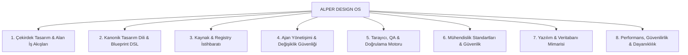

# ALPER DESIGN OS

> **"Arayüzü tasarlamadan önce ürünü, alanı ve operasyonel bağlamı anla."**

[](LICENSE_POLICY.md)
[](tsconfig.json)
[](plugin.json)
[-brightgreen.svg)](tests/)
[](packages/mcp-server/)
[](scripts/)

**ALPER DESIGN OS**, sıradan bir bileşen veya UI kütüphanesi değildir. Yazılım alanlarını (domain) derinlemesine anlayan, kullanıcı iş akışlarını ve ergonomisini analiz eden, kurumsal seviyede mimari ve UX/UI kararları alan, sıfırdan ürün tasarlayan veya mevcut devasa sistemleri cerrahi/aşamalı olarak modernize eden **AI-Native, Teknoloji Bağımsız Tasarım ve UX Geliştirme İşletim Sistemi**'dir.

Bünyesinde **57 adet Antigravity Yeteneği (Skill)**, **88 adet tip güvenli MCP Aracı** ve **8 farklı frontend/backend adaptörü** barındırır.

---

## 🌟 Temel Mimarî Sütunlar

1. **Teknoloji Bağımsız Tasarım (Technology Agnostic):**
   Tasarım tokenları, grid modelleri, erişilebilirlik ve UX desenleri framework kodundan tamamen ayrıştırılmıştır. Sözleşme tabanlı **Adaptör Mimarisi** ile tek bir mimari mantıktan 8 farklı teknolojiye derleme yapılır:
   * **HTML5 / CSS3 / ES6+ JavaScript**
   * **TypeScript**
   * **React (JSX)**
   * **React + TypeScript (Strict)**
   * **PHP (Native View/Template)**
   * **Laravel / Blade**
   * **ASP.NET Core / Razor Pages & Blazor**
   * **Generic Web (Vanilla Standartları)**

2. **Domain Intelligence (Alan İstihbaratı İlk İlkedir):**
   Asla körlemesine UI üretilmez. Ürünün alanı (APS Üretim Planlama, WMS Depo, Finans, Hastane vb.), operatör personelleri, bilgi yoğunluğu (Information Density) ve kritik iş akışları analiz edilerek tip güvenli bir `ProductUXProfile` oluşturulur.

3. **Üç Farklı Çalışma Modu:**
   * `NEW`: Alan istihbaratı ve operatör ergonomisi odaklı yeşil alan (greenfield) tasarımı.
   * `REPAIR`: Mevcut teknoloji ve tasarım dilini koruyarak yapılan cerrahi onarım.
   * `MODERNIZE`: Eski sistemleri bozmadan, 4 aşamalı aşamalı geçişle modern tasarım tokenlarına ve erişilebilir gridlere dönüştürme.

4. **Kanonik Tasarım Dili & UI Blueprint DSL:**
   Kullanıcı arayüzünü deklaratif JSON formatında tanımlayan `UI Blueprint DSL` ile tasarımlar modellenir; tek bir blueprint'ten farklı framework adaptörlerinde semantik eşdeğerlik (**Cross-Stack Parity**) garanti edilir.

5. **Gerçekçi UI Politikası & Veri Kaynağı Kanıtı (Truthful UI & Data Provenance):**
   Gerçek olmayan sahte telemetri, uydurma KPI veya kaynaksız metriklerin gösterilmesi engellenir. Veriler `PROVENANCE_SOURCE` (`AUTHORITATIVE`, `DERIVED`, `MOCK_SYNTHETIC`) seviyelerine göre açıkça etiketlenir ve `CONTENT_TRUTH_PASS` kapısı ile denetlenir.

6. **Operatör Destekli Çalışma (Operator-Assisted Execution):**
   Kurumsal güvenlik yazılımlarının (EDR/Xcitium) kısıtladığı ortamlarda agent-çocuk süreçlerini zorlamak yerine, güvenli `HUMAN_OPERATOR_EXECUTION` mimarisiyle PowerShell bundle'ları (`RUN.ps1`) üretir ve toplanan kanıtları matematiksel kesinlikle doğrular (`verifiedBy: ALPER_DESIGN_OS`).

7. **Akıllı Tarayıcı Çözümleyicisi (Browser Fallback Chain):**
   Kurumsal güvenlik politikalarının managed Chromium indirmelerini engellediği durumlarda otomatik olarak işletim sisteminde kurulu **Microsoft Edge** (`msedge`) veya Chrome'a düşer; Playwright E2E testlerini sıfır kesintiyle çalıştırır.

8. **Ajan Yönetişimi & Değişiklik Güvenliği (Agent Governance):**
   17 adımlı sıkı yaşam döngüsü, `AgentActionPlan`, etki alanı (blast radius) değerlendirmesi, yıkıcı komut koruması, bağımsız gözden geçirici kapısı ve kanıt temelli doğrulama.

---

## 🧠 57 Uzmanlaşmış Yetenek (Antigravity Skills)

### Yetenek (Skill) Nedir ve Nasıl Çalışır?
Alper Design OS içerisindeki **Skill'ler**, yapay zeka ajanının sıradan bir metin tamamlayıcı gibi değil; **kıdemli bir baş mimar, güvenlik denetçisi veya UX araştırmacısı** gibi hareket etmesini sağlayan kurallar, kılavuzlar ve iş akışları paketidir.

Bir istekte bulunduğunuzda (örneğin *"bu projeyi modernize et"* veya *"veritabanı migrasyon riskini denetle"*), yapay zeka ajanı ilgili yeteneği otomatik olarak yükler, o alana özgü katı mühendislik kurallarını (`SKILL.md`) okur ve 88 MCP aracı arasından gerekenleri disiplinli bir sırayla çalıştırır.

57 yetenek **8 ana uzmanlık alanında** organize edilmiştir:



### 1. Çekirdek Tasarım & Alan İş Akışları (Core Design & Domain)
| Yetenek | Rolü ve Açıklaması |
| :--- | :--- |
| `alper-design-new` | **Sıfırdan Ürün Tasarımı:** Alan araştırması yapar, stack adaptörünü belirler, DTCG tokenlarını ve tasarım planını üretir. |
| `alper-design-repair` | **Cerrahi Arayüz Onarımı:** Mevcut mimariyi ve stack'i bozmadan; erişilebilirlik, taşma ve etkileşim sürtünmelerini onarır. |
| `alper-design-modernize` | **4 Aşamalı Modernizasyon:** Eski projeleri (Legacy PHP/ASP vb.) kesintisiz adımlarla modern token ve gridlere dönüştürür. |
| `alper-domain-intelligence` | **Alan İstihbaratı:** APS, Depo, Hastane, Finans vb. 15 sektör için operatör profili ve `ProductUXProfile` çıkarır. |
| `alper-design-personality` | **Tasarım Karakteri:** Jenerik ve basmakalıp AI tasarımlarını önleyen 6 eksenli kuantitatif tasarım karakteri motoru. |
| `alper-pattern-graph` | **28 Kanonik UX Deseni:** Gantt, Split Pane, Dense DataGrid, Command Palette desenlerini alana uygun uygular. |
| `alper-design-critic` | **Tasarım Eleştirmeni:** Kontrast ihlallerini, layout shift risklerini ve yoğunluk uyumsuzluklarını önceden denetler. |

### 2. Kanonik Tasarım Dili & UI Blueprint DSL
| Yetenek | Rolü ve Açıklaması |
| :--- | :--- |
| `alper-ui-blueprint` | **Deklaratif Blueprint DSL:** Sayfa ve bileşen yapısını, durumlarını ve erişilebilirlik sözleşmelerini JSON ile modeller. |
| `alper-ui-recipe` | **Standart UI Reçeteleri:** Yaygın sayfa şablonları, bölgeler, bileşen etkileşimleri ve duyarlı davranışları tanımlar. |
| `alper-cross-stack-rendering` | **Çapraz Stack Derleme:** Tek bir blueprint'ten HTML, React, Blade ve Razor kodlarını semantik olarak üretir. |
| `alper-renderer-parity` | **Parite Doğrulama:** Farklı adaptörlerin görsel hiyerarşi, etkileşim davranışı ve asset boyutlarının denkliğini garanti eder. |

### 3. Kaynak, Registry & Bileşen İstihbaratı (Source Intelligence V2)
| Yetenek | Rolü ve Açıklaması |
| :--- | :--- |
| `alper-source-intelligence` | **Yetkili Tasarım Sistemleri:** 65+ kurumsal tasarım sistemi (Ant, Carbon, Material, Atlassian vb.) ve primitive'leri analiz eder. |
| `alper-design-source-ranking` | **Gerekçeli Kaynak Sıralaması:** Proje gereksinimlerine göre kütüphaneleri ağırlıklı skorlar ve *NEDEN (WHY)* açıklaması sunar. |
| `alper-registry-discovery` | **Topluluk Registry Keşfi:** shadcn/ui, Magic UI, Aceternity, Kokonut gibi ekosistemlerden hazır blokları keşfeder. |
| `alper-ai-skill-audit` | **AI Skill Güvenlik Taraması:** Üçüncü taraf AI tasarım yeteneklerinde prompt-injection veya zararlı komut sızıntılarını denetler. |

### 4. Ajan Yönetişimi, Güvenlik & Yaşam Döngüsü (Agent Governance)
| Yetenek | Rolü ve Açıklaması |
| :--- | :--- |
| `alper-change-planner` | **17 Adımlı Değişiklik Planı:** `AgentActionPlan`, etki alanı analizi (blast radius) ve geri alma (rollback) senaryoları hazırlar. |
| `alper-scope-guard` | **Kapsam Koruyucu:** İzin verilmeyen dosya değişikliklerini ve gizli kapsam genişlemelerini (unauthorized scope creep) engeller. |
| `alper-git-safety` | **Git Çalışma Ağacı Koruma:** `git reset --hard`, `force push` gibi yıkıcı komutları engeller, güvenli checkpoint yönetir. |
| `alper-evidence-review` | **13 Somut Kanıt Denetimi:** "Tamamen test edildi" gibi kanıtsız beyanları yasaklar; log, ekran görüntüsü veya test sonucu arar. |
| `alper-independent-review` | **Bağımsız Kod Gözden Geçirme:** Geliştirici ajanın öz-onayına güvenmeden çalışan, tarafsız ikinci bir denetim gözü sunar. |
| `alper-regression-guard` | **Regresyon Kalkanı:** Değişiklik öncesi davranışsal taban çizgisi (baseline) oluşturur ve gizli kırılmaları yakalar. |
| `alper-safe-refactor` | **Güvenli Yeniden Yapılandırma:** Davranışı koruyan, minimum etki alanına sahip cerrahi refactoring adımları uygular. |

### 5. Tarayıcı, QA & Doğrulama Motoru (Browser QA & Testing)
| Yetenek | Rolü ve Açıklaması |
| :--- | :--- |
| `alper-browser-qa` | **Tarayıcı QA Orkestratörü:** Playwright ve Chrome DevTools MCP araçlarını birleştirerek uçtan uca doğrulama yapar. |
| `alper-playwright-testing` | **Rol Tabanlı Playwright Testi:** Kırılgan CSS/XPath seçicileri yerine erişilebilir semantik roller (`getByRole`) ile test yazar. |
| `alper-runtime-debugging` | **Çalışma Zamanı Hata Ayıklama:** Konsol hatalarını, yakalanmamış exception'ları ve network (4xx/5xx/CORS) açıklarını inceler. |
| `alper-visual-regression` | **Piksel Düzeyinde Görsel Regresyon:** 4 ayrı viewport (Mobil, Tablet, Masaüstü, Büyük Ekran) ve temada görsel diff çıkarır. |
| `alper-accessibility-testing` | **Erişilebilirlik (a11y) Taraması:** axe-core, klavye gezintisi ve WCAG 2.1 AA/AAA standartlarını doğrular. |
| `alper-cross-browser-testing` | **Çapraz Tarayıcı Matrisi:** Chromium, Edge, Firefox, WebKit ve mobil emülasyon üzerinde tutarlılığı denetler. |
| `alper-testing-strategy` | **Test Piramidi Sentezi:** Statik analizden E2E ve yük testine kadar projeye özgü ideal test piramidini kurar. |
| `alper-regression-testing` | **Kritik Huni Testleri:** Kullanıcı dönüşüm ve ödeme gibi hassas akışları koruyan otomatik regresyon paketleri çalıştırır. |

### 6. Mühendislik Standartları & Güvenlik (Engineering Guardrails)
| Yetenek | Rolü ve Açıklaması |
| :--- | :--- |
| `alper-secure-coding` | **Güvenli Kodlama:** OWASP Top 10 2025 ve ASVS 5.0 standartlarında güvenli kodlama kurallarını uygulatır. |
| `alper-security-audit` | **Güvenlik & Açık Denetimi:** Pasif güvenlik taraması yapar ve bulguları release gate engellerine göre değerlendirir. |
| `alper-api-security` | **API Güvenliği:** OWASP API Security Top 10 denetimleri (BOLA, Broken Auth, Mass Assignment vb.) gerçekleştirir. |
| `alper-secret-management` | **Sır Sızıntılarını Engelleme:** Token, API anahtarı veya şifrelerin commit edilmesini engeller; `[REDACTED_*]` ile maskeler. |
| `alper-ai-coding-safety` | **AI Halüsinasyon Savunması:** Yapay zekanın uydurduğu sahte paketleri, importları ve tedarik zinciri tuzaklarını engeller. |
| `alper-supply-chain-security` | **Tedarik Zinciri Güvenliği:** NIST SSDF, SLSA provenance ve CycloneDX SBOM (Software Bill of Materials) üretir. |
| `alper-dependency-hygiene` | **Bağımlılık Hijyeni:** CVE açıkları, gereksiz şişkinlikler ve lockfile tutarsızlıklarını denetler. |
| `alper-dependency-lifecycle` | **Bağımlılık Yaşam Döngüsü:** Paket güncellemeleri ve sürüm politikalarını (SemVer) yönetir. |
| `alper-code-quality` | **Kod Kalitesi:** Tip denetimleri, linter kuralları ve siklomatik karmaşıklık limitlerini uygulatır. |

### 7. Yazılım & Veritabanı Mimarisi İstihbaratı (Software Intelligence)
| Yetenek | Rolü ve Açıklaması |
| :--- | :--- |
| `alper-architecture` | **Mimari Stil Keşfi:** Projedeki mimari yapıyı (11 stil: Clean, Hexagonal, Event-Driven vb.) ve alt sistem sınırlarını belirler. |
| `alper-architecture-audit` | **Mimari Denetim:** Spagetti kuplaj, dairesel bağımlılıklar ve katman ihlallerini tespit eder. |
| `alper-database-engineering` | **Veritabanı Mühendisliği:** Şema normalizasyonu, indeksleme stratejileri ve bağlantı havuzu yapılandırmasını yönetir. |
| `alper-sql-performance` | **SQL Performansı:** N+1 sorgu döngülerini ve eksik foreign key indekslerini tespit eder; keyset pagination uygulatır. |
| `alper-migration-safety` | **Migrasyon Güvenliği:** DDL operasyonlarını (SAFE/REVIEW/DANGEROUS) sınıflandırır ve Expand/Contract desenini zorunlu kılar. |
| `alper-data-integrity` | **Veri Bütünlüğü:** ACID işlemleri, idempotency anahtarları ve dağıtık veri tutarlılığı kurallarını yönetir. |
| `alper-api-architecture` | **API Mimarisi:** OpenAPI/AsyncAPI spesifikasyonlarını inceler ve geriye dönük kırıcı değişiklikleri (breaking changes) engeller. |
| `alper-refactoring-strategy` | **Refactoring Yol Haritası:** Strangler Fig ve Branch-by-Abstraction ile risk almadan kod tabanını yeniler; ADR üretir. |

### 8. Performans, Güvenilirlik & Dayanıklılık (Reliability & Resilience)
| Yetenek | Rolü ve Açıklaması |
| :--- | :--- |
| `alper-performance-engineering` | **Performans Mühendisliği:** Core Web Vitals (LCP, INP, CLS), asset bütçeleri ve alt-saniye operasyon hızlarını denetler. |
| `alper-performance-testing` | **Performans Testi:** Lighthouse ve Chrome DevTools izleri (traces) ile layout shift ve uzun süren görevleri yakalar. |
| `alper-reliability` | **Sistem Güvenilirliği:** SLI/SLO hedefleri, circuit breaker (devre kesici) ve kademeli üstel bekleme (exponential backoff) kurar. |
| `alper-resilience` | **Hata Toleransı:** Bulkhead izolasyonu, rate limiter'lar ve graceful degradation (zarif gerileme) mekanizmaları kurar. |
| `alper-observability` | **Gözlemlenebilirlik (O11y):** OpenTelemetry tracing, metrikler, PII maskelemeli loglama ve korelasyon ID'leri kurgular. |
| `alper-release-safety` | **Güvenli Sürümleme:** Canary sürümleri, OpenFeature flag'leri ve kesintisiz (zero-downtime) geçiş kapılarını yönetir. |
| `alper-contract-testing` | **Sözleşme Testi:** Servisler arası API entegrasyonlarını Pact tüketici odaklı sözleşmelerle kilitler. |
| `alper-load-testing` | **Yük & Stres Testi:** Grafana k6 kullanarak kontrollü eşzamanlı kullanıcı trafiği altında verimlilik testi yapar. |

---

## 📁 Proje Dizin Yapısı

```text
alper-design-os/
├── plugin.json                 # Antigravity Plugin Tanımı (57 Yetenek Kayıtlı)
├── mcp_config.json             # MCP Sunucu Konfigürasyonu
├── hooks.json                  # Yaşam Döngüsü Hook'ları
├── pnpm-workspace.yaml         # Monorepo Workspace Konfigürasyonu
│
├── skills/                     # 57 Uzmanlaşmış Antigravity Yeteneği
│   ├── alper-design-new/       # Sıfırdan Ürün Tasarım Akışı
│   ├── alper-design-repair/    # Cerrahi Arayüz Onarım Akışı
│   ├── alper-design-modernize/ # 4 Aşamalı Modernizasyon Akışı
│   ├── alper-domain-intelligence/ # Alan & Operatör İstihbaratı
│   ├── alper-ui-blueprint/     # UI Blueprint DSL
│   ├── alper-playwright-testing/ # Rol Tabanlı Playwright E2E Testi
│   ├── alper-change-planner/   # 17 Adımlı Değişiklik Yaşam Döngüsü
│   └── ...                     # (Toplam 57 adet yetenek klasörü)
│
├── scripts/                    # Otomasyon ve Sistem Sağlık Araçları
│   ├── install-windows.ps1     # Otomatik Windows Kurulum Scripti
│   ├── update.ps1              # Tek Tıkla Git & Derleme Güncelleyici
│   ├── doctor.js               # Çapraz Platform Sağlık ve Tanı Motoru (Adım 1-9)
│   ├── doctor.ps1              # PowerShell Sistem Tanı Scripti
│   ├── register-mcp.js         # Antigravity MCP Konfigürasyon Kaydedici
│   ├── operator-runtime-check.js # Operatör Çalışma Zamanı Kanıt Toplayıcı
│   └── verify-bundle.js        # Operatör Kanıt Doğrulayıcı
│
├── design-core/                # Teknoloji Bağımsız Tasarım Çekirdeği
│   ├── src/domain/             # 15 Alan Benchmark'ı & ProductUXProfile
│   ├── src/tokens/             # DTCG Tokenları (Style Dictionary Uyumlu)
│   ├── src/layout/             # Multi-Pane Workbench & DataGrid Layoutları
│   └── src/ux-patterns/        # 28 Kanonik UX Deseni (Gantt, SplitPane vb.)
│
├── adapters/                   # Framework Adaptörleri (Sözleşme Tabanlı)
│   ├── contract/               # Ortak AdapterContract & BaseAdapter
│   ├── html-css-js/            # Semantik HTML5 + CSS3 + ES6 JS
│   ├── react/                  # React (JSX)
│   ├── react-typescript/       # React + Strict TypeScript
│   ├── php/                    # Native PHP Şablonları
│   ├── laravel-blade/          # Laravel Blade + Alpine.js
│   └── aspnet-razor/           # ASP.NET Core Razor Pages & Blazor
│
├── packages/
│   ├── analyzer/               # Kod ve Stack Algılama, UI/A11y Statik Denetleyici
│   ├── agent-governance/       # 17 Adım Yaşam Döngüsü, Operatör Paketi, Truthful UI
│   ├── design-language/        # Kanonik Tasarım Dili, UI Blueprint DSL, Cross-Stack Render
│   ├── source-intelligence/    # 65+ Tasarım Sistemi, Registry Keşfi ve Skorlama
│   ├── engineering-guardrails/ # Kalite Profilleri, STRIDE Tehdit Modeli, Güvenli Tarama
│   ├── qa-engine/              # Playwright, DevTools, Görsel Regresyon, QA Raporlayıcı
│   ├── software-intelligence/  # Mimari Stil Tespiti, DB Migrasyon Riski, ADR Üretimi
│   └── mcp-server/             # 88 Tipli Araç İçeren Resmi MCP Sunucusu
│
├── tests/                      # 16 Test Süiti, 326 Otomatik Vitest Testi
│   ├── domain-benchmark-15.test.ts
│   ├── design-language.test.ts
│   ├── truthful-ui-governance.test.ts
│   ├── operator-assisted-execution.test.ts
│   ├── mcp-server.test.ts
│   └── ...
│
└── docs/                       # Mimari & Kullanım Dokümantasyonu
    ├── operator-assisted-execution.md
    ├── truthful-ui-policy.md
    ├── canonical-design-language.md
    └── product-ux-profile.md
```

---

## 🚀 Kurulum (Adım Adım)

Proje tamamen taşınabilir (portable) olarak tasarlanmıştır. Hiçbir yerde sabit kullanıcı adı veya işletim sistemine bağımlı mutlak yol bulunmaz.

### 1. Ön Koşullar
* **İşletim Sistemi:** Windows 10/11, macOS veya Linux
* **Node.js:** `v20.x` veya `v24.x LTS` ([nodejs.org](https://nodejs.org/))
* **Git:** [git-scm.com](https://git-scm.com/)
* *(İsteğe Bağlı)* Docker Desktop & Microsoft Edge (Playwright E2E testleri için)

### 2. Projeyi Klonlayın
```bash
git clone https://github.com/alperates58/alper-design-os.git
cd alper-design-os
```

### 3. Bağımlılıkları Yükleyin ve Derleyin
```bash
npm install
npm run build
```
*(Bu komut 19 monorepo paketini sırayla TypeScript ile derler ve `dist/` klasörlerini oluşturur).*

### 4. MCP Sunucusunu IDE / Asistanınıza Kaydedin
Antigravity veya MCP destekli araçlarınıza tek komutla bağlayın:
```bash
node scripts/register-mcp.js
```
*(Windows kullanıcıları alternatif olarak `.\scripts\install-windows.ps1` dosyasını da çalıştırabilir).*

### 5. Sistem Sağlık Taraması (Doctor)
Tüm bileşenlerin, derleme çıktılarının ve araçların eksiksiz olduğunu doğrulamak için:
```bash
npm run doctor
```

### 6. Tüm Testleri Çalıştırın
```bash
npm test
```
Tüm 16 test dosyasında **326 testin tamamının eksiksiz geçtiğini** görmelisiniz.

---

## 🛠️ MCP Sunucusu & 88 Güçlü Araç

`alper-design-os` MCP sunucusu 10 temel kategoride **88 adet tip güvenli araç** sunar:

| Kategori | Araç Sayısı | Öne Çıkan Araçlar | İlgili Yetenekler (Skills) |
| :--- | :---: | :--- | :--- |
| **Ürün & Alan Analizi** | 4 | `understand_product`, `research_domain`, `recommend_ux_patterns`, `search_design_patterns` | `alper-domain-intelligence`, `alper-design-new` |
| **Tasarım Token & Blueprint** | 9 | `get_design_tokens`, `create_page_blueprint`, `create_component_blueprint`, `create_app_shell_blueprint`, `render_blueprint`, `render_component`, `compare_renderer_parity` | `alper-ui-blueprint`, `alper-ui-recipe`, `alper-cross-stack-rendering` |
| **Statik UI & Modernizasyon** | 5 | `analyze_project`, `detect_stack`, `audit_existing_ui`, `audit_accessibility`, `recommend_modernization` | `alper-design-repair`, `alper-design-modernize`, `alper-accessibility-testing` |
| **Kaynak & Registry İstihbaratı** | 20 | `discover_design_sources`, `search_patterns`, `search_registries`, `recommend_chart_library`, `recommend_data_grid`, `explain_source_recommendation` | `alper-source-intelligence`, `alper-registry-discovery`, `alper-design-source-ranking` |
| **Mühendislik & Güvenlik** | 7 | `generate_engineering_policy`, `evaluate_release_gates`, `generate_threat_model`, `detect_tool_capabilities`, `run_safe_security_scan` | `alper-secure-coding`, `alper-security-audit`, `alper-supply-chain-security` |
| **QA, Test & Playwright** | 4 | `generate_user_journeys`, `generate_playwright_test`, `generate_qa_report`, `generate_test_pyramid` | `alper-browser-qa`, `alper-playwright-testing`, `alper-testing-strategy` |
| **Yazılım & Veritabanı Mimarisi** | 5 | `analyze_architecture`, `generate_adr`, `analyze_database_schema`, `evaluate_api_compatibility`, `classify_code_paths` | `alper-architecture`, `alper-database-engineering`, `alper-migration-safety` |
| **Ajan Yönetişimi (Governance)** | 14 | `create_action_plan`, `evaluate_scope`, `evaluate_change_risk`, `create_checkpoint_plan`, `create_verification_plan`, `review_change`, `detect_regression` | `alper-change-planner`, `alper-scope-guard`, `alper-git-safety`, `alper-independent-review` |
| **Truthful UI & Kanıt Şeffaflığı** | 6 | `evaluate_truthful_ui`, `audit_data_provenance`, `evaluate_page_intent`, `audit_information_relevance`, `classify_source_authority`, `manage_human_visual_approval` | `alper-evidence-review`, `alper-design-critic` |
| **Operatör Yürütme Motoru** | 4 | `create_manual_run_bundle`, `verify_manual_run_evidence`, `resolve_browser_runtime`, `run_operator_doctor` | `alper-cross-browser-testing`, `alper-runtime-debugging` |

---

## 💬 Örnek Promptlar (Kullanım Rehberi)

Aşağıdaki hazır promptları Antigravity, Cursor veya Claude arayüzünde doğrudan kullanabilirsiniz:

### 1. Yeni Ürün & Alan Analizi (NEW Modu)
*Tetiklenen Yetenekler:* `alper-design-new`, `alper-domain-intelligence`, `alper-ui-blueprint`
```text
Yeni bir Endüstriyel Üretim Planlama Sistemi (APS - Advanced Planning & Scheduling) geliştiriyoruz.
Operatörler fabrika sahasındaki 40 tezgahın iş sıralamasını ve darboğazlarını saniyelik takip ediyor.
Lütfen 'understand_product' ve 'research_domain' araçlarını kullanarak:
1. Alan sınıflandırmasını ve bilgi yoğunluğunu (information density) belirle.
2. Bu operatörler için en uygun UX desenlerini (Gantt, Split Pane, Dense DataGrid) seç.
3. React + TypeScript ve Tailwind için UI Blueprint DSL tanımını üret.
```

### 2. Eski Kod Tabanını Aşamalı Modernleştirme (MODERNIZE Modu)
*Tetiklenen Yetenekler:* `alper-design-modernize`, `alper-design-repair`, `alper-refactoring-strategy`
```text
Elimizde 2014 yılından kalma native PHP ve spaghetti jQuery ile yazılmış bir Müşteri Sipariş Yönetim ekranı var.
'recommend_modernization' ve 'audit_existing_ui' araçlarını çalıştırarak:
1. Mevcut ekranı bozmadan 4 aşamalı (Tokenization -> Layout Isolation -> Component Replacement -> Full Decoupling) geçiş planı hazırla.
2. Form girdilerini ve tabloları DTCG uyumlu CSS değişkenleriyle eşleştir.
3. Laravel Blade veya React TypeScript adaptörüne güvenli geçiş yol haritasını çıkar.
```

### 3. Cerrahi Arayüz Onarımı (REPAIR Modu)
*Tetiklenen Yetenekler:* `alper-design-repair`, `alper-accessibility-testing`, `alper-scope-guard`
```text
Mevcut projemizde mobil kırılma noktalarında (390px) veri tablomuz taşıyor ve form butonları ekran dışına kayıyor.
'audit_responsive' ve 'audit_accessibility' araçlarını kullanarak:
1. Yatay taşma (layout overflow) ve WCAG kontrast açıklarını tespit et.
2. Projenin mevcut CSS/Tailwind yapısını bozmadan cerrahi bir düzeltme öner.
3. Düzeltmenin yan etkilerini kontrol etmek için 'evaluate_scope' çalıştır.
```

### 4. Gerçekçi UI & Sahte Veri Tespiti (Truthful UI Audit)
*Tetiklenen Yetenekler:* `alper-evidence-review`, `alper-design-critic`
```text
Projemizdeki lojistik takip panelinde gösterilen sıcaklık ve yakıt grafikleri gerçek sensör verisi mi yoksa uydurma random sayılar mı?
'audit_data_provenance' ve 'evaluate_truthful_ui' araçlarını kullanarak:
1. Tüm veri kaynaklarını (Authoritative, Derived, Mock Synthetic) sınıflandır.
2. Canlı donanım bağlantısı olmayan metrikleri 'SIMULATED_ESTIMATE' olarak açıkça etiketle.
3. 'CONTENT_TRUTH_PASS' onay kapısını çalıştırarak sahte telemetriyi engelle.
```

### 5. Veritabanı & Mimari Değişiklik Risk Denetimi
*Tetiklenen Yetenekler:* `alper-database-engineering`, `alper-migration-safety`, `alper-change-planner`
```text
Kullanıcı tablosuna 10 milyon kayıt içeren bir sistemde 'last_login_ip' kolonu eklemek ve indekslemek istiyoruz.
'analyze_database_schema' ve 'evaluate_change_risk' araçlarını kullanarak:
1. Bu DDL işleminin kilitlenme (table-lock) riskini ve geriye dönük uyumluluğunu değerlendir.
2. Sıfır kesinti (Zero-Downtime Expand/Contract) migrasyon stratejisi için ADR oluştur.
```

### 6. Operatör Destekli Güvenli Çalıştırma (HUMAN_OPERATOR_EXECUTION)
*Tetiklenen Yetenekler:* `alper-playwright-testing`, `alper-runtime-debugging`, `alper-evidence-review`
```text
Kurumsal bilgisayarda güvenlik kısıtlamaları nedeniyle doğrudan child-process çalıştıramıyoruz.
Lütfen 'create_manual_run_bundle' aracını kullanarak bir runtime doğrulama paketi hazırla:
- Bana çalıştırmam gereken tek '.\.alper-design-os\manual-runs\<run-id>\RUN.ps1' komutunu ver.
- Ben PowerShell'de çalıştırdıktan sonra 'verify_manual_run_evidence' ile toplanan gerçek Docker, Playwright Edge ve test kanıtlarını doğrula.
```

---

## 🔒 Güvenlik & Doğruluk Taahhüdü

* **Sıfır Sahte Doğrulama (No Fake Pass):** Gerçek bir tarayıcı veya container üzerinde test edilmeyen hiçbir özellik geçerli ("PASS") kabul edilmez; açıkça `UNVERIFIED` veya `DEFERRED` olarak etiketlenir.
* **Gizlilik ve Sır Maskeleme (Zero Secret Leak):** API anahtarları, JWT tokenlar, DB parolaları ve kurumsal veriler loglarda, testlerde ve commitlerde otomatik olarak `[REDACTED_*]` ile maskelenir.
* **Kurumsal Uyumluluk (No Security Bypass):** Hiçbir güvenlik servisini devre dışı bırakmaz, antivirüs/EDR bypass etmez veya yetki yükseltme (privilege escalation) yapmaz.

---

## 📄 Lisans

Bu proje [MIT Lisansı](LICENSE_POLICY.md) ile lisanslanmıştır.
© 2026 Alper Ateş. Tüm hakları saklıdır.
