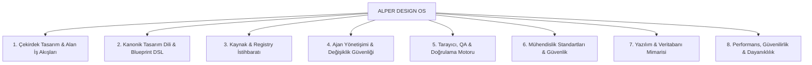
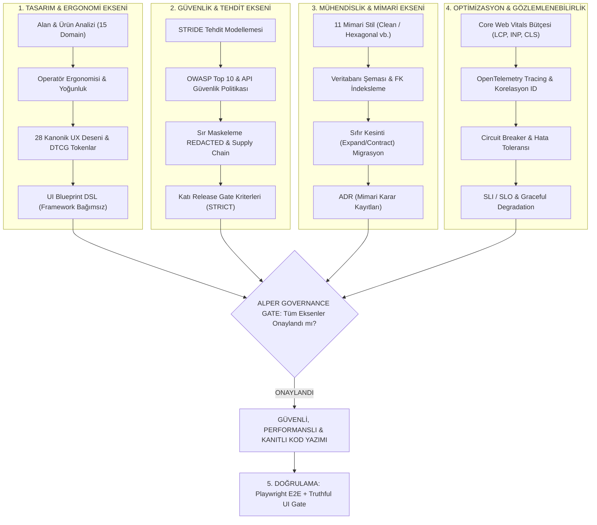

# ALPER DESIGN OS

> **"Arayüzü tasarlamadan önce ürünü, alanı ve operasyonel bağlamı anla."**

[](LICENSE)
[](tsconfig.json)
[-emerald.svg)](plugin.json)
[-brightgreen.svg)](tests/)
[](packages/mcp-server/)
[-brightgreen.svg)](.github/workflows/ci.yml)
[](scripts/)
[](pnpm-lock.yaml)

**ALPER DESIGN OS**, sıradan bir bileşen veya UI kütüphanesi değildir. Yazılım alanlarını (domain) derinlemesine anlayan, kullanıcı iş akışlarını ve ergonomisini analiz eden, kurumsal seviyede mimari ve UX/UI kararları alan, sıfırdan ürün tasarlayan veya mevcut devasa sistemleri cerrahi/aşamalı olarak modernize eden **AI-Native, Teknoloji Bağımsız Tasarım ve UX Geliştirme İşletim Sistemi**'dir.

Bünyesinde **74 adet Antigravity Yeteneği (55 aktif, 19 deprecated)**, **124 adet tip güvenli MCP Aracı**, **8 farklı frontend/backend adaptörü**, **Mevcut Proje Modernizasyon Motoru (Phase 1F)**, **Sıfırdan Proje Üretim Motoru (Phase 1G)**, **Kalıcı Proje İstihbarat Motoru (Phase 1H Project Intelligence)**, **Mimari Doğruluk & Evrensel Kanıt Katmanı (Phase 1H.1)**, **Taşınabilirlik, CI/CD & Dağıtım Motoru (Phase 1I)** ve **Installer Sertleştirmesi & V1.0 Sürüm Hazırlığı (Phase 1K)** barındırır.


---

## 🌟 Temel Mimarî Sütunlar

1. **Teknoloji Bağımsız Tasarım (Technology Agnostic):**
   Tasarım tokenları, grid modelleri, erişilebilirlik ve UX desenleri framework kodundan tamamen ayrıştırılmıştır. Sözleşme tabanlı **Adaptör Mimarisi** ile tek bir mimari mantıktan 8 farklı teknolojiye derleme yapılır:
   * **HTML5 / CSS3 / ES6+ JavaScript**
   * **TypeScript**
   * **React (JSX)**
   * **React + TypeScript (Strict)**
   * **PHP (Native View/Template)**
   * **Laravel / Blade**
   * **ASP.NET Core / Razor Pages & Blazor**
   * **Generic Web (Vanilla Standartları)**

2. **Domain Intelligence (Alan İstihbaratı İlk İlkedir):**
   Asla körlemesine UI üretilmez. Ürünün alanı (APS Üretim Planlama, WMS Depo, Finans, Hastane vb.), operatör personelleri, bilgi yoğunluğu (Information Density) ve kritik iş akışları analiz edilerek tip güvenli bir `ProductUXProfile` oluşturulur.

3. **Üç Farklı Çalışma Modu:**
   * `NEW`: Alan istihbaratı ve operatör ergonomisi odaklı yeşil alan (greenfield) tasarımı.
   * `REPAIR`: Mevcut teknoloji ve tasarım dilini koruyarak yapılan cerrahi onarım.
   * `MODERNIZE`: Eski sistemleri bozmadan, 4 aşamalı aşamalı geçişle modern tasarım tokenlarına ve erişilebilir gridlere dönüştürme.

4. **Kanonik Tasarım Dili & UI Blueprint DSL:**
   Kullanıcı arayüzünü deklaratif JSON formatında tanımlayan `UI Blueprint DSL` ile tasarımlar modellenir; tek bir blueprint'ten farklı framework adaptörlerinde semantik eşdeğerlik (**Cross-Stack Parity**) garanti edilir.

5. **Gerçekçi UI Politikası & Veri Kaynağı Kanıtı (Truthful UI & Data Provenance):**
   Gerçek olmayan sahte telemetri, uydurma KPI veya kaynaksız metriklerin gösterilmesi engellenir. Veriler `PROVENANCE_SOURCE` (`AUTHORITATIVE`, `DERIVED`, `MOCK_SYNTHETIC`) seviyelerine göre açıkça etiketlenir ve `CONTENT_TRUTH_PASS` kapısı ile denetlenir.

6. **Operatör Destekli Çalışma (Operator-Assisted Execution):**
   Kurumsal güvenlik yazılımlarının (EDR/Xcitium) kısıtladığı ortamlarda agent-çocuk süreçlerini zorlamak yerine, güvenli `HUMAN_OPERATOR_EXECUTION` mimarisiyle PowerShell bundle'ları (`RUN.ps1`) üretir ve toplanan kanıtları matematiksel kesinlikle doğrular (`verifiedBy: ALPER_DESIGN_OS`).

7. **Akıllı Tarayıcı Çözümleyicisi (Browser Fallback Chain):**
   Kurumsal güvenlik politikalarının managed Chromium indirmelerini engellediği durumlarda otomatik olarak işletim sisteminde kurulu **Microsoft Edge** (`msedge`) veya Chrome'a düşer; Playwright E2E testlerini sıfır kesintiyle çalıştırır.

8. **Ajan Yönetişimi & Değişiklik Güvenliği (Agent Governance):**
   17 adımlı sıkı yaşam döngüsü, `AgentActionPlan`, etki alanı (blast radius) değerlendirmesi, yıkıcı komut koruması, bağımsız gözden geçirici kapısı ve kanıt temelli doğrulama.

9. **Mevcut Proje Modernizasyon Motoru (Phase 1F.0 Modernization Engine Foundation):**
   Mevcut kurumsal projeleri güvenli şekilde anlama ve cerrahi modernizasyon planı çıkarma yeteneği. Standardize pipeline:
   `EXISTING PROJECT -> UNDERSTAND -> BASELINE -> PRESERVE -> CLASSIFY -> PLAN -> PROPOSE -> HUMAN SELECT -> APPLY -> VERIFY`
   * **Big Bang Rewrite Varsayılan Olarak Yasak:** Yalnızca açık kullanıcı talebi ve yüksek gerekçeyle kontrollü shell rebuild'e izin verilir; güvenli `BRIDGE` yaklaşımı önceliklidir.
   * **Preservation Contract (Koruma Sözleşmesi):** Backend mantığı, DB şeması, API ve Auth katmanları `MUST_PRESERVE` ile kilitlenir.
   * **Scope Guard:** Sayfa seviyesi görevler asla sessizce uygulama geneline veya veritabanına genişleyemez.
   * **Human Visual Approval:** Tasarım yönü adayları (A: High-Density Workbench, B: Modular Cards, C: Streamlined Stepper) insan görsel onayı olmadan yayına alınamaz.

10. **Sıfırdan Proje Üretim Motoru (Phase 1G Greenfield Generation Engine V1):**
    Kullanıcı brifinginden tam çalışan projeye giden uçtan uca üretim motoru:
    `BRIEF -> PRODUCT UNDERSTANDING -> DOMAIN RESEARCH -> REQUIREMENTS (RTM) -> ARCHITECTURE -> DATA MODEL -> API MODEL -> UX MODEL -> DESIGN SYSTEM -> PLAN -> SCAFFOLD -> VERIFY`
    * **Anti-Overengineering & Karmaşıklık Bütçesi:** Küçük CRUD ve dahili araçlar için mikroservis, Kafka ve Kubernetes kesinlikle varsayılan değildir; `MONOLITH` veya `MODULAR_MONOLITH` (karmaşıklık puanı $\le 3$) zorunludur.
    * **Gereksinim İzlenebilirlik Matrisi (RTM):** %100 fonksiyonel gereksinim mimari karara, veritabanı modeline, API uç noktasına, UI sayfasına ve otomatik teste bağlanır.
    * **8 Durumlu Eksiksiz Sayfa Modeli:** Her sayfa için `LOADING`, `EMPTY`, `SUCCESS`, `ERROR`, `PARTIAL`, `UNAUTHORIZED`, `FORBIDDEN`, `OFFLINE` durumları context-aware modellenir.
    * **Çoklu Stack Desteği:** React+TypeScript (Strict), Laravel+Blade, ASP.NET Core+Razor ve Plain HTML/CSS/JS için derlenebilir proje scaffolding'i.

11. **Proje İstihbaratı, Kalıcı Bellek & Sürekli İyileştirme (Phase 1H Project Intelligence V1):**
    Ajanların her oturumda projeyi baştan keşfetme amnezisini bitiren, `.alper-design-os/project/` altında versiyon kontrollü kalıcı hafıza:
    * **Sıfır Gizli Veri Depolama:** API key, token, şifre ve bağlantı dizgeleri otomatik olarak tespit edilip `[REDACTED]` ile maskelenir.
    * **ADR Yaşam Döngüsü & Çift Yönlü Superseding:** Kararlar asla sessizce ezilmez; eski karar `SUPERSEDED`, yeni karar `supersedes` ile şeffaf şekilde bağlanır.
    * **Mimari Bağımlılık Grafiği & Snapshot:** Gerçek kod analizinden üretilen `ProjectArchitectureGraph`, fingerprint snapshot'ları ve otomatik drift tespiti.
    * **Değişiklik Etki Analizi (Blast Radius):** Kod değişikliği öncesinde etkilenen modül, endpoint, sayfa ve testleri hesaplar; risk puanı çıkarır.
    * **Sürekli İyileştirme & Çapraz Proje İzolasyonu:** Proje içi öğrenilen dersler (`LessonLearnedRecord`), insan yönetişim onayı olmadan genel kurala dönüştürülemez.

12. **Mimari Doğruluk & Evrensel Kanıt İlkeleri (Phase 1H.1 Architecture Integrity Remediation):**
    A1 Bağımsız Denetimi bulgularını kalıcı olarak kapatan ve sistem geneline yayılan evrensel ilke:
    * **NO CLAIM WITHOUT EVIDENCE (Kanıtsız İddia Yasaktır):** Türetilmiş gereksinimler (`deriveRequirements`) asla baştan `VERIFIED` kabul edilmez; ilk durumları `DEFINED / NOT_VERIFIED` olmak zorundadır. Eksik kanıt daima `NOT_VERIFIED` döner, asla `PASS` veya `VERIFIED HIGH` olamaz.
    * **Üretilen Kod $\neq$ Derlenebilir Kod:** Scaffolding çıktısı (`scaffoldNewProject`), somut bir derleyici veya test yürütmesi gerçekleşmedikçe `buildStatus: 'NOT_VERIFIED'`, `buildable: false` bildirmek zorundadır.
    * **Domain Grounding & Sahte Varlık Yasağı:** Fiil kelimelerinden ("manages", "reviews") veya jenerik takılardan (`PrimaryEntity`, `inventory_items`) veritabanı tablosu uydurulması kesinlikle yasaktır. Grounded iş nesneleri türetilemiyorsa sistem durur (`DiscoveryReadiness: NEEDS_CLARIFICATION`) ve 3–5 odaklı soru sorar.
    * **Boş Repolarda Sıfır Halüsinasyon:** Kod bulunmayan klasörlerde `AppCore`, `DataModule`, `inventory_items` gibi sahte modüller veya sahte `%90 EXCELLENT` sağlık skorları üretilemez (`INSUFFICIENT_DATA / 0%`).
    * **MCP Tek Doğruluk Kaynağı (Single Source of Truth):** 124 MCP aracı tekil `canonicalToolRegistry` (`packages/mcp-server/src/tools/definitions.ts`) üzerinden dinamik sunulur; elle tutulan switch yapısı silinmiştir ve `dist/` sürekli güncel tutulur.
    * **Sektörel Tarafsızlık (Non-APS Domain Neutrality):** Çekirdek tasarım ve layout motorlarından sabit fabrika/APS terimleri kaldırılmış, her sektöre (Saas, Finans, Sağlık, Eğitim vb.) tarafsız istihbarat sağlanmıştır.

13. **Yetenek Mimarisi İyileştirmesi & Ajan Orkestrasyon Standardizasyonu (Phase 1H.2 Skill Architecture Remediation):**
    A1 Bağımsız Denetimi (F-08, F-09) bulgularını kapatan, 72 mikro-taslağı 55 aktif kanonik yetenek ve 19 kalıcı olarak kullanımdan kaldırılmış (deprecated) yetenek şeklinde konsolide eden, `ALPER_SKILL_STANDARD_V1` ve `SKILL_QUALITY_GATE_V1` mimarisi:
    * **17 Sınırlandırılmış Yetenek Ailesi:** Ad-hoc keşif kirliliği sonlandırıldı; tüm yetenekler 17 aile altında toplandı (`PRODUCT_DISCOVERY`, `GREENFIELD_ENGINEERING`, `EXISTING_PROJECT_ANALYSIS`, `REPAIR`, `MODERNIZATION`, `PROJECT_INTELLIGENCE`, `GOVERNANCE`, `TRUTHFUL_UI`, `OPERATOR_EXECUTION`, `ARCHITECTURE`, `DATA_ENGINEERING`, `API_ENGINEERING`, `DESIGN_UX`, `SOURCE_INTELLIGENCE`, `SECURITY`, `QA_TESTING`, `PERFORMANCE_RELIABILITY`).
    * **%100 MCP Araç Erişilebilirliği (0 Yetim Araç):** 124 kanonik MCP aracının tamamı deterministik mülkiyetle aktif yeteneklere bağlandı.
    * **Sıfır Çift Başlı (Split-Brain) Yönlendirme:** `alper-design-new`, `alper-design-modernize`, `alper-safe-refactor` gibi eski Phase 0 yetenekleri kullanımdan kaldırıldı ve `context-router.ts` içerisinden tamamen çıkarıldı.
    * **Kademeli İfşa (Progressive Disclosure):** Karmaşık yetenekler (`stack-templates.md`, `preservation-checklist.md`, vb.) `references/` dizinleri altında derinleştirildi.
    * **6 Ajan Personası Standardizasyonu:** `agents/*.md` dosyaları rol, girdiler, çıktılar, araç sınırları ve el sıkışma (handoff) protokolü ile tipikleştirildi.
    * **Yıkıcı Komut Koruması:** `hooks.json` ve `scripts/guard-destructive-command.js` ile `git reset --hard` / `git push --force` gibi operasyonlar engellendi.
    * **Kanıt Ayrımı:** `HOOK_SCRIPT_RUNTIME = VERIFIED`, `HOOK_STATIC_CONFIG = VERIFIED`, `ANTIGRAVITY_HOOK_INTEGRATION = NOT_VERIFIED` statüleri açıkça belgelendi.

14. **Phase 1H.2B Kapanış Düzeltmesi (Evidence Taxonomy, Traceability & WCAG 2.2 AA Truth):**
    * **Kanonik Kanıt Taksonomisi:** Tüm 55 aktif yetenekten sahte `EvidenceKind` değerleri (`BUILD_OUTPUT`, `SECURITY_REPORT`, `DATABASE_ANALYSIS`, `PERFORMANCE_TRACE` vb.) temizlendi; production `EvidenceKind` enum'ına (`STATIC_ANALYSIS`, `RUNTIME_CHECK`, vb.) bağlandı ve somut artefaktlar `evidenceArtifacts` olarak modellendi.
    * **WCAG 2.2 AA Kanonik Standart:** Tüm yeşil alan (greenfield) motorları ve mimari profilleri için kanonik erişilebilirlik varsayılanı `WCAG_2_2_AA` olarak eşitlendi; geriye dönük WCAG 2.1 AA uyumluluğu korundu.
    * **Dinamik Bağımlılık Güdümlü Fazlandırma:** Sabit "7-Aşamalı Plan" iddiası kaldırıldı; projenin veritabanı, API, kimlik doğrulama ve raporlama ihtiyaçlarına göre dinamik aşama türetimi sağlandı.
    * **RTM Doğruluğu & Sıfır Sahte Hedef:** Eksik mimari ve veritabanı artefaktlarında sahte string (`DECISION_MONOLITH`, `users`, `/api/v1/health` vb.) uydurma davranışı silindi; bulunamayan hedefler `undefined` ve `UNRESOLVED` ile izlenemeyen gereksinimler doğru şekilde `ORPHAN` olarak işaretlendi.
    * **Mimari Yetenek Uyumu:** `alper-architecture` yeteneği `recommendArchitecture()` motoruna uygun şekilde güncellendi; küçük CRUD projelerinde modüler monolit önceliği korunurken mikroservis mimarisine aşırı ölçek durumlarında izin veren gerçekçi kural seti sağlandı.
    * **Taşınan Doğrulama Borcu:** `GENERATED_PROJECT_REAL_BUILDS = NOT_VERIFIED` statüsü korunarak Phase 1I öncesi dürüst kanıt temeli sağlandı.

15. **Taşınabilirlik, CI/CD, Bootstrap & Dağıtım Motoru (Phase 1I & Phase 1I Closure Hotfix):**
    * **Kanonik Paket Yöneticisi:** `pnpm@9.15.4` ve `pnpm-lock.yaml` dondurulmuş kilit dosyasıyla (`--frozen-lockfile`) tam deterministik bağımlılık yönetimi; plansız/sessiz npm fallback'leri kaldırılmıştır.
    * **Çift Modlu Doctor Teşhisi:** `node scripts/doctor.js --preflight` ile kurulum öncesi gereksinim ve gizli veri (secret) taraması; kurulum sonrası tam kapsamlı mimari bütünlük ve MCP doğrulaması.
    * **Kapsamlı CI/CD Mimarisi:** GitHub Actions üzerinde ikiye ayrılmış güvenli pipeline:
      - **Job A (Core Portability Matrix):** Ubuntu, Windows, macOS × Node 20.x, 22.x üzerinde 6 çapraz platform işinin tamamı (%100) başarıyla yeşildir.
      - **Job B (Generated Project Native Build Certification & Packaging):** .NET 8 SDK ve PHP 8.2 + Composer ile donatılmış ortamda 4 stack'in (`REACT_TYPESCRIPT`, `LARAVEL_BLADE`, `ASPNET_RAZOR`, `PLAIN_HTML_CSS_JS`) gerçek derleyici, CLI ve sözdizimi doğrulaması.
    * **Taşınan Doğrulama Borcunun Kapatılması:** `GENERATED_PROJECT_REAL_BUILDS = VERIFIED` statüsüne resmi olarak yükseltilmiştir (Gerçek GitHub Actions Çalışma ID: `38569682373`, Sonuç: `success`).
    * **Antigravity MCP Kapsamı & Sürüm Sabitleme:** `node scripts/register-mcp.js` varsayılan olarak yalnızca projeye özel `.agents/mcp_config.json` içine `alper-design-os` sunucusunu kaydeder; isteğe bağlı tarayıcı MCP sunucuları (`chrome-devtools-mcp@0.12.0`, `@playwright/mcp@0.0.6`) kesin sürümlerle (`@latest` yasak) kaydedilir.
    * **Pre-v1 Dağıtım Paketleme:** `dist-release/alper-design-os-1.0.0-rc.1.tar.gz`, `release-manifest.json` ve SHA-256 sağlama toplamları otomatik üretilir ve CI artefaktı olarak depolanır.

16. **Stabilizasyon, Installer Sertleştirmesi & V1.0 Sürüm Hazırlığı (Phase 1K):**
    * **Windows / Unicode Taşınabilirlik Sözleşmesi:** `fileURLToPath(import.meta.url)` standartlaştırılmasıyla Türkçe/Unicode (`KİŞİSEL PROJELER`) ve boşluk içeren klasörlerde CLI ve installer'ların sessizce sonlanma problemi kökten çözülmüştür.
    * **PowerShell Kısıtlı Çalışma Ortamı Koruması:** `ExecutionPolicy` kısıtlamalarına karşı doğrudan `cmd.exe /c` ve Node.js `.cmd` alternatifleri (`bootstrap.cmd`, `doctor.cmd`, `scripts/*.cmd`) sağlanmıştır; hiçbir güvenlik politikası bypass edilmez.
    * **Kanonik 10-Aşamalı Ajan Kurulum Sözleşmesi:** `INSPECT → SELECT DESTINATION → CLONE/UPDATE → BOOTSTRAP → BUILD → TEST → REGISTER → DOCTOR → MCP HANDSHAKE → REPORT` sözleşmesi Antigravity ajanları için net ve deterministik hale getirilmiştir.
    * **Taşınan Workspace Junction Onarımı:** Yeniden konumlandırılan pnpm junction/symlink bağlantıları otomatik yakalanıp dondurulmuş kilit dosyasıyla onarılır.
    * **MCP stdio JSON-RPC Doğrulaması:** 124 kanonik araç stdio handshake ve gerçek Antigravity IDE çağrılarıyla canlı doğrulanmıştır (`ANTIGRAVITY_MCP_RUNTIME = VERIFIED`).
    * **538 Otomatik Test Güvencesi:** 25 test paketinde 538 test %100 yeşildir.

---

## 🧠 74 Uzmanlaşmış Yetenek (55 Aktif, 19 Deprecated)

### Yetenek (Skill) Nedir ve Nasıl Çalışır?
Alper Design OS içerisindeki **Skill'ler**, yapay zeka ajanının sıradan bir metin tamamlayıcı gibi değil; **kıdemli bir baş mimar, güvenlik denetçisi veya UX araştırmacısı** gibi hareket etmesini sağlayan kurallar, kılavuzlar ve iş akışları paketidir.

Bir istekte bulunduğunuzda (örneğin *"bu projeyi modernize et"* veya *"veritabanı migrasyon riskini denetle"*), yapay zeka ajanı ilgili yeteneği otomatik olarak yükler, o alana özgü katı mühendislik kurallarını (`SKILL.md`) okur ve 124 MCP aracı arasından gerekenleri disiplinli bir sırayla çalıştırır.

74 yetenek (55 aktif, 19 deprecated) **17 sınırlandırılmış yetenek ailesinde** organize edilmiştir:



### 1. Çekirdek Tasarım & Alan İş Akışları (Core Design & Domain)
| Yetenek | Rolü ve Açıklaması |
| :--- | :--- |
| `alper-design-new` | **Sıfırdan Ürün Tasarımı:** Alan araştırması yapar, stack adaptörünü belirler, DTCG tokenlarını ve tasarım planını üretir. |
| `alper-design-repair` | **Cerrahi Arayüz Onarımı:** Mevcut mimariyi ve stack'i bozmadan; erişilebilirlik, taşma ve etkileşim sürtünmelerini onarır. |
| `alper-design-modernize` | **4 Aşamalı Modernizasyon:** Eski projeleri (Legacy PHP/ASP vb.) kesintisiz adımlarla modern token ve gridlere dönüştürür. |
| `alper-domain-intelligence` | **Alan İstihbaratı:** APS, Depo, Hastane, Finans vb. 15 sektör için operatör profili ve `ProductUXProfile` çıkarır. |
| `alper-design-personality` | **Tasarım Karakteri:** Jenerik ve basmakalıp AI tasarımlarını önleyen 6 eksenli kuantitatif tasarım karakteri motoru. |
| `alper-pattern-graph` | **28 Kanonik UX Deseni:** Gantt, Split Pane, Dense DataGrid, Command Palette desenlerini alana uygun uygular. |
| `alper-design-critic` | **Tasarım Eleştirmeni:** Kontrast ihlallerini, layout shift risklerini ve yoğunluk uyumsuzluklarını önceden denetler. |

### 2. Kanonik Tasarım Dili & UI Blueprint DSL
| Yetenek | Rolü ve Açıklaması |
| :--- | :--- |
| `alper-ui-blueprint` | **Deklaratif Blueprint DSL:** Sayfa ve bileşen yapısını, durumlarını ve erişilebilirlik sözleşmelerini JSON ile modeller. |
| `alper-ui-recipe` | **Standart UI Reçeteleri:** Yaygın sayfa şablonları, bölgeler, bileşen etkileşimleri ve duyarlı davranışları tanımlar. |
| `alper-cross-stack-rendering` | **Çapraz Stack Derleme:** Tek bir blueprint'ten HTML, React, Blade ve Razor kodlarını semantik olarak üretir. |
| `alper-renderer-parity` | **Parite Doğrulama:** Farklı adaptörlerin görsel hiyerarşi, etkileşim davranışı ve asset boyutlarının denkliğini garanti eder. |

### 3. Kaynak, Registry & Bileşen İstihbaratı (Source Intelligence V2)
| Yetenek | Rolü ve Açıklaması |
| :--- | :--- |
| `alper-source-intelligence` | **Yetkili Tasarım Sistemleri:** 65+ kurumsal tasarım sistemi (Ant, Carbon, Material, Atlassian vb.) ve primitive'leri analiz eder. |
| `alper-design-source-ranking` | **Gerekçeli Kaynak Sıralaması:** Proje gereksinimlerine göre kütüphaneleri ağırlıklı skorlar ve *NEDEN (WHY)* açıklaması sunar. |
| `alper-registry-discovery` | **Topluluk Registry Keşfi:** shadcn/ui, Magic UI, Aceternity, Kokonut gibi ekosistemlerden hazır blokları keşfeder. |
| `alper-ai-skill-audit` | **AI Skill Güvenlik Taraması:** Üçüncü taraf AI tasarım yeteneklerinde prompt-injection veya zararlı komut sızıntılarını denetler. |

### 4. Ajan Yönetişimi, Güvenlik & Yaşam Döngüsü (Agent Governance)
| Yetenek | Rolü ve Açıklaması |
| :--- | :--- |
| `alper-change-planner` | **17 Adımlı Değişiklik Planı:** `AgentActionPlan`, etki alanı analizi (blast radius) ve geri alma (rollback) senaryoları hazırlar. |
| `alper-scope-guard` | **Kapsam Koruyucu:** İzin verilmeyen dosya değişikliklerini ve gizli kapsam genişlemelerini (unauthorized scope creep) engeller. |
| `alper-git-safety` | **Git Çalışma Ağacı Koruma:** `git reset --hard`, `force push` gibi yıkıcı komutları engeller, güvenli checkpoint yönetir. |
| `alper-evidence-review` | **13 Somut Kanıt Denetimi:** "Tamamen test edildi" gibi kanıtsız beyanları yasaklar; log, ekran görüntüsü veya test sonucu arar. |
| `alper-independent-review` | **Bağımsız Kod Gözden Geçirme:** Geliştirici ajanın öz-onayına güvenmeden çalışan, tarafsız ikinci bir denetim gözü sunar. |
| `alper-regression-guard` | **Regresyon Kalkanı:** Değişiklik öncesi davranışsal taban çizgisi (baseline) oluşturur ve gizli kırılmaları yakalar. |
| `alper-safe-refactor` | **Güvenli Yeniden Yapılandırma:** Davranışı koruyan, minimum etki alanına sahip cerrahi refactoring adımları uygular. |

### 5. Tarayıcı, QA & Doğrulama Motoru (Browser QA & Testing)
| Yetenek | Rolü ve Açıklaması |
| :--- | :--- |
| `alper-browser-qa` | **Tarayıcı QA Orkestratörü:** Playwright ve Chrome DevTools MCP araçlarını birleştirerek uçtan uca doğrulama yapar. |
| `alper-playwright-testing` | **Rol Tabanlı Playwright Testi:** Kırılgan CSS/XPath seçicileri yerine erişilebilir semantik roller (`getByRole`) ile test yazar. |
| `alper-runtime-debugging` | **Çalışma Zamanı Hata Ayıklama:** Konsol hatalarını, yakalanmamış exception'ları ve network (4xx/5xx/CORS) açıklarını inceler. |
| `alper-visual-regression` | **Piksel Düzeyinde Görsel Regresyon:** 4 ayrı viewport (Mobil, Tablet, Masaüstü, Büyük Ekran) ve temada görsel diff çıkarır. |
| `alper-accessibility-testing` | **Erişilebilirlik (a11y) Taraması:** axe-core, klavye gezintisi ve WCAG 2.1 AA/AAA standartlarını doğrular. |
| `alper-cross-browser-testing` | **Çapraz Tarayıcı Matrisi:** Chromium, Edge, Firefox, WebKit ve mobil emülasyon üzerinde tutarlılığı denetler. |
| `alper-testing-strategy` | **Test Piramidi Sentezi:** Statik analizden E2E ve yük testine kadar projeye özgü ideal test piramidini kurar. |
| `alper-regression-testing` | **Kritik Huni Testleri:** Kullanıcı dönüşüm ve ödeme gibi hassas akışları koruyan otomatik regresyon paketleri çalıştırır. |

### 6. Mühendislik Standartları & Güvenlik (Engineering Guardrails)
| Yetenek | Rolü ve Açıklaması |
| :--- | :--- |
| `alper-secure-coding` | **Güvenli Kodlama:** OWASP Top 10 2025 ve ASVS 5.0 standartlarında güvenli kodlama kurallarını uygulatır. |
| `alper-security-audit` | **Güvenlik & Açık Denetimi:** Pasif güvenlik taraması yapar ve bulguları release gate engellerine göre değerlendirir. |
| `alper-api-security` | **API Güvenliği:** OWASP API Security Top 10 denetimleri (BOLA, Broken Auth, Mass Assignment vb.) gerçekleştirir. |
| `alper-secret-management` | **Sır Sızıntılarını Engelleme:** Token, API anahtarı veya şifrelerin commit edilmesini engeller; `[REDACTED_*]` ile maskeler. |
| `alper-ai-coding-safety` | **AI Halüsinasyon Savunması:** Yapay zekanın uydurduğu sahte paketleri, importları ve tedarik zinciri tuzaklarını engeller. |
| `alper-supply-chain-security` | **Tedarik Zinciri Güvenliği:** NIST SSDF, SLSA provenance ve CycloneDX SBOM (Software Bill of Materials) üretir. |
| `alper-dependency-hygiene` | **Bağımlılık Hijyeni:** CVE açıkları, gereksiz şişkinlikler ve lockfile tutarsızlıklarını denetler. |
| `alper-dependency-lifecycle` | **Bağımlılık Yaşam Döngüsü:** Paket güncellemeleri ve sürüm politikalarını (SemVer) yönetir. |
| `alper-code-quality` | **Kod Kalitesi:** Tip denetimleri, linter kuralları ve siklomatik karmaşıklık limitlerini uygulatır. |

### 7. Yazılım & Veritabanı Mimarisi İstihbaratı (Software Intelligence)
| Yetenek | Rolü ve Açıklaması |
| :--- | :--- |
| `alper-architecture` | **Mimari Stil Keşfi:** Projedeki mimari yapıyı (11 stil: Clean, Hexagonal, Event-Driven vb.) ve alt sistem sınırlarını belirler. |
| `alper-architecture-audit` | **Mimari Denetim:** Spagetti kuplaj, dairesel bağımlılıklar ve katman ihlallerini tespit eder. |
| `alper-database-engineering` | **Veritabanı Mühendisliği:** Şema normalizasyonu, indeksleme stratejileri ve bağlantı havuzu yapılandırmasını yönetir. |
| `alper-sql-performance` | **SQL Performansı:** N+1 sorgu döngülerini ve eksik foreign key indekslerini tespit eder; keyset pagination uygulatır. |
| `alper-migration-safety` | **Migrasyon Güvenliği:** DDL operasyonlarını (SAFE/REVIEW/DANGEROUS) sınıflandırır ve Expand/Contract desenini zorunlu kılar. |
| `alper-data-integrity` | **Veri Bütünlüğü:** ACID işlemleri, idempotency anahtarları ve dağıtık veri tutarlılığı kurallarını yönetir. |
| `alper-api-architecture` | **API Mimarisi:** OpenAPI/AsyncAPI spesifikasyonlarını inceler ve geriye dönük kırıcı değişiklikleri (breaking changes) engeller. |
| `alper-refactoring-strategy` | **Refactoring Yol Haritası:** Strangler Fig ve Branch-by-Abstraction ile risk almadan kod tabanını yeniler; ADR üretir. |

### 8. Performans, Güvenilirlik & Dayanıklılık (Reliability & Resilience)
| Yetenek | Rolü ve Açıklaması |
| :--- | :--- |
| `alper-performance-engineering` | **Performans Mühendisliği:** Core Web Vitals (LCP, INP, CLS), asset bütçeleri ve alt-saniye operasyon hızlarını denetler. |
| `alper-performance-testing` | **Performans Testi:** Lighthouse ve Chrome DevTools izleri (traces) ile layout shift ve uzun süren görevleri yakalar. |
| `alper-reliability` | **Sistem Güvenilirliği:** SLI/SLO hedefleri, circuit breaker (devre kesici) ve kademeli üstel bekleme (exponential backoff) kurar. |
| `alper-resilience` | **Hata Toleransı:** Bulkhead izolasyonu, rate limiter'lar ve graceful degradation (zarif gerileme) mekanizmaları kurar. |
| `alper-observability` | **Gözlemlenebilirlik (O11y):** OpenTelemetry tracing, metrikler, PII maskelemeli loglama ve korelasyon ID'leri kurgular. |
| `alper-release-safety` | **Güvenli Sürümleme:** Canary sürümleri, OpenFeature flag'leri ve kesintisiz (zero-downtime) geçiş kapılarını yönetir. |
| `alper-contract-testing` | **Sözleşme Testi:** Servisler arası API entegrasyonlarını Pact tüketici odaklı sözleşmelerle kilitler. |
| `alper-load-testing` | **Yük & Stres Testi:** Grafana k6 kullanarak kontrollü eşzamanlı kullanıcı trafiği altında verimlilik testi yapar. |

### 9. Mevcut Proje Modernizasyonu (Modernization Engine — Phase 1F)
| Yetenek | Rolü ve Açıklaması |
| :--- | :--- |
| `alper-existing-project-analysis` | **Mevcut Proje Analizi:** Stack, mimari stil, teknik/görsel/UX borç heuristiği ve kritik iş akışlarını çıkarır. |
| `alper-modernization-planner` | **Modernizasyon Planlayıcı:** Aşamalı plan (Stage 1-5), KEEP/IMPROVE/REPLACE/DEFER/REMOVE sınıflandırması ve tasarım adayları üretir. |
| `alper-behavior-preservation` | **Davranış Koruma & Sözleşme:** Rotaları, API sözleşmelerini, DB invariantlarını ve auth mekanizmalarını dondurur; regresyonu önler. |
| `alper-modernization-review` | **Modernizasyon Gözden Geçirici:** Kapsam sadakati, gereksiz rewrite önleme, bağımlılık kontrolü ve görsel onay kapısını denetler. |

### 10. Sıfırdan Proje Üretimi (Greenfield Generation Engine — Phase 1G)
| Yetenek | Rolü ve Açıklaması |
| :--- | :--- |
| `alper-greenfield-product-analysis` | **Ürün Analizi & Profil:** Ham brifingden `GreenfieldProjectProfile`, risk, varsayım ve operasyonel kısıtları çıkarır. |
| `alper-requirements-engineering` | **Gereksinim Mühendisliği & RTM:** Fonksiyonel/NF gereksinimler, Gherkin kabul kriterleri ve %100 izlenebilirlik matrisi oluşturur. |
| `alper-architecture-planner` | **Mimarî Planlayıcı:** Karmaşıklık bütçesi hesabı, anti-overengineering guardrail (mikroservis/Kafka yasağı) ve stil seçimi yapar. |
| `alper-database-designer` | **Veritabanı Tasarımcısı:** Normalizasyon, ilişkiler, indeksleme, migrasyonlar ve veri sınıflandırma/maskeleme tasarlar. |
| `alper-api-designer` | **API Tasarımcısı:** OpenAPI 3.1.0 uyumlu REST API, standart hata/sayfalama zarfları ve oturum/RBAC güvenliği tasarlar. |
| `alper-greenfield-generator` | **Uçtan Uca Yeşil Alan Üreticisi:** Master blueprint sentezi, 7 aşamalı uygulama planı ve 4 stack için derlenebilir scaffolding üretir. |

### 11. Proje İstihbaratı, Kalıcı Bellek & Sürekli İyileştirme (Phase 1H)
| Yetenek | Rolü ve Açıklaması |
| :--- | :--- |
| `alper-project-intelligence` | **Proje İstihbarat Yöneticisi:** `.alper-design-os/project` kalıcı hafızasını, manifest, profil ve mimari grafiği yönetir. |
| `alper-decision-management` | **Karar Yönetimi & ADR:** ADR yaşam döngüsünü, çift yönlü superseding'i ve reddedilen alternatifleri kayıt altına alır. |
| `alper-change-impact-analysis` | **Değişiklik Etki Analizi:** Modül/veri/API değişikliklerinde bağımlılık grafiği üzerinden blast radius ve risk hesaplar. |
| `alper-project-continuation` | **Proje Sürekliliği:** Yeni oturumlarda ve ajanlarda projeyi sıfırdan keşfetmeden anında bağlam oluşturur. |
| `alper-continuous-improvement` | **Sürekli İyileştirme:** Öğrenilen dersleri belgeler; insan onaylı kurumsal yönetişimle iyileştirme adayları sunar. |

---

## 📁 Proje Dizin Yapısı

```text
alper-design-os/
├── plugin.json                 # Antigravity Plugin Tanımı
├── mcp_config.json             # MCP Sunucu Konfigürasyonu
├── hooks.json                  # Yaşam Döngüsü Hook'ları (Yıkıcı Komut Koruması)
├── pnpm-workspace.yaml         # Monorepo Workspace Konfigürasyonu
│
├── .alper-design-os/project/   # Versiyon Kontrollü Kalıcı Proje İstihbaratı (Phase 1H)
│   ├── manifest.json           # Proje Kimliği ve Versiyon Haritası
│   ├── architecture.json       # Mimari Standartlar ve Kararlar
│   ├── invariants.json         # Kırılmaz Sistem Kuralları (Security/Data/API)
│   ├── decisions/              # ADR Arşivi (Çift Yönlü Superseding)
│   ├── knowledge/              # Doğrulanmış İş Kuralları ve Terimler Sözlüğü
│   └── snapshots/              # Mimari ve Sözleşme Fingerprint Snapshot'ları
│
├── skills/                     # 74 Antigravity Yeteneği (55 Aktif Kanonik + 19 Deprecated)
│   ├── alper-truthful-ui/               # Gerçekçi UI & Kaynak Otoritesi (Phase 1H.2)
│   ├── alper-operator-execution/        # Kurumsal Çalıştırma & RUN.ps1 (Phase 1H.2)
│   ├── alper-project-intelligence/      # Kalıcı Proje Belleği (Phase 1H)
│   ├── alper-decision-management/       # ADR ve Superseding (Phase 1H)
│   ├── alper-change-impact-analysis/    # Değişiklik Etki Analizi (Phase 1H)
│   ├── alper-project-continuation/      # Proje Süreklilik Özeti (Phase 1H)
│   ├── alper-continuous-improvement/    # Öğrenilen Dersler & İyileştirme (Phase 1H)
│   ├── alper-greenfield-generator/      # Uçtan Uca Greenfield Üretim (Phase 1G)
│   ├── alper-requirements-engineering/  # Gereksinim ve RTM (Phase 1G)
│   ├── alper-existing-project-analysis/ # Mevcut Proje Analizi (Phase 1F)
│   └── ...                     # (Toplam 72 adet yetenek klasörü)
│
├── scripts/                    # Otomasyon ve Sistem Sağlık Araçları
│   ├── install-windows.ps1     # Otomatik Windows Kurulum Scripti
│   ├── update.ps1              # Tek Tıkla Git & Derleme Güncelleyici
│   ├── doctor.js               # Çapraz Platform Sağlık ve Tanı Motoru (Adım 1-9)
│   ├── doctor.ps1              # PowerShell Sistem Tanı Scripti
│   ├── register-mcp.js         # Antigravity MCP Konfigürasyon Kaydedici
│   ├── operator-runtime-check.js # Operatör Çalışma Zamanı Kanıt Toplayıcı
│   └── verify-bundle.js        # Operatör Kanıt Doğrulayıcı
│
├── design-core/                # Teknoloji Bağımsız Tasarım Çekirdeği
│   ├── src/domain/             # 15 Alan Benchmark'ı & ProductUXProfile
│   ├── src/tokens/             # DTCG Tokenları (Style Dictionary Uyumlu)
│   ├── src/layout/             # Multi-Pane Workbench & DataGrid Layoutları
│   └── src/ux-patterns/        # 28 Kanonik UX Deseni (Gantt, SplitPane vb.)
│
├── adapters/                   # Framework Adaptörleri (Sözleşme Tabanlı)
│   ├── contract/               # Ortak AdapterContract & BaseAdapter
│   ├── html-css-js/            # Semantik HTML5 + CSS3 + ES6 JS
│   ├── react/                  # React (JSX)
│   ├── react-typescript/       # React + Strict TypeScript
│   ├── php/                    # Native PHP Şablonları
│   ├── laravel-blade/          # Laravel Blade + Alpine.js
│   └── aspnet-razor/           # ASP.NET Core Razor Pages & Blazor
│
├── packages/
│   ├── analyzer/               # Kod ve Stack Algılama, UI/A11y Statik Denetleyici
│   ├── agent-governance/       # 17 Adım Yaşam Döngüsü, Operatör Paketi, Truthful UI
│   ├── design-language/        # Kanonik Tasarım Dili, UI Blueprint DSL, Cross-Stack Render
│   ├── source-intelligence/    # 65+ Tasarım Sistemi, Registry Keşfi ve Skorlama
│   ├── engineering-guardrails/ # Kalite Profilleri, STRIDE Tehdit Modeli, Güvenli Tarama
│   ├── qa-engine/              # Playwright, DevTools, Görsel Regresyon, QA Raporlayıcı
│   ├── software-intelligence/  # Mimari Stil Tespiti, DB Migrasyon Riski, ADR Üretimi
│   └── mcp-server/             # 124 Tipli Araç İçeren Resmi MCP Sunucusu
│
├── tests/                      # 21 Test Süiti, 468 Otomatik Vitest Testi (%100 Başarı)
│   ├── skill-architecture-1h2.test.ts # Faz 1H.2 Yetenek Mimarisi Standart Doğrulama
│   ├── semantic-integrity-1h1.test.ts # Faz 1H.1 Mimari Doğruluk & Adversarial Doğrulama
│   ├── project-intelligence.test.ts   # Faz 1H Proje İstihbaratı & Kalıcı Bellek Süiti
│   ├── greenfield-engine.test.ts      # Faz 1G Sıfırdan Proje Üretim Motoru Süiti
│   ├── modernization-engine.test.ts   # Faz 1F Modernizasyon Motoru Süiti
│   ├── domain-benchmark-15.test.ts
│   ├── design-language.test.ts
│   ├── truthful-ui-governance.test.ts
│   ├── operator-assisted-execution.test.ts
│   ├── mcp-server.test.ts
│   └── ...
│
└── docs/                       # Mimari & Kullanım Dokümantasyonu
    ├── skill-engineering-standard.md         # Faz 1H.2 Yetenek Mimarisi Standardı (V1)
    ├── architecture-integrity-remediation.md # Faz 1H.1 Kanıt İlkeleri & Audit Kapanışları
    ├── project-intelligence.md
    ├── decision-lifecycle.md
    ├── change-impact-analysis.md
    ├── continuous-improvement.md
    ├── greenfield-generation.md
    ├── requirements-traceability.md
    ├── architecture-selection.md
    ├── project-blueprint.md
    ├── truthful-ui-policy.md
    ├── canonical-design-language.md
    └── product-ux-profile.md
```

---

## 🚀 Kurulum (Tek Komutla Hızlı Başlangıç)

Proje tamamen taşınabilir (portable) olarak tasarlanmıştır. Hiçbir yerde makineye özel mutlak yol veya sabit ortam bilgisi bulunmaz. Ayrıntılı kurulum belgeleri için [INSTALL.md](INSTALL.md) ve AI ajan kurulum sözleşmesi için [INSTALL_AGENT.md](INSTALL_AGENT.md) dosyalarını inceleyebilirsiniz.

### 1. Ön Koşullar
* **İşletim Sistemi:** Windows 10/11, macOS veya Linux
* **Node.js:** `>= 20.0.0` (Önerilen: `v22.x LTS`) ([nodejs.org](https://nodejs.org/))
* **Git:** `>= 2.30.0` ([git-scm.com](https://git-scm.com/))
* *(İsteğe Bağlı)* .NET SDK 8+, PHP 8.2+ & Composer, Docker, Playwright

### 2. Projeyi Klonlayın ve Bootstrap Edin

#### **Linux / macOS / Git Bash:**
```bash
git clone https://github.com/alperates58/alper-design-os.git
cd alper-design-os
./scripts/bootstrap.sh
```

#### **Windows (PowerShell):**
```powershell
git clone https://github.com/alperates58/alper-design-os.git
cd alper-design-os
.\scripts\bootstrap.ps1
```
*(Bootstrap işlemi dondurulmuş paket bağımlılıklarını çözer, tüm 18 monorepo paketini derler ve Doctor V2 sağlık taramasını çalıştırır).*

### 3. MCP Sunucusunu IDE / Antigravity'ye Kaydedin
Antigravity veya MCP destekli araçlarınıza tek komutla bağlayın:
```bash
node scripts/register-mcp.js
```

### 4. Sistem Sağlık Taraması (Doctor V2)
Tüm bileşenlerin, derleme çıktılarının, 124 MCP aracının ve 74 yeteneğin eksiksiz olduğunu doğrulamak için:
```bash
npm run doctor
```

### 5. Tüm Testleri Çalıştırın
```bash
npm test
```
Tüm 22 test dosyasında **503 testin tamamının eksiksiz geçtiğini** görmelisiniz.

### 6. Güvenli Güncelleme (Safe Update)
```bash
npm run update
```
*(Alper Design OS asla yerel değişiklikleri silmez (`git reset --hard` çalıştırmaz); kirli çalışma alanlarında otomatik olarak durur ve kontrol noktası oluşturur).*

---

## 🏗️ Sıfırdan Projeye Başlama Kılavuzu: 360° Bütünsel Yazılım Döngüsü

Geleneksel yazılım geliştirme süreçlerinde ekipler genellikle önce kodu yazar, ardından tasarımı giydirmeye çalışır; güvenlik ve performans ise en son aşamada "yama" olarak eklenmeye çalışılır. Bu durum; güvenlik açıkları, mimari tıkanıklıklar, yavaş arayüzler ve devasa teknik borç (technical debt) ile sonuçlanır.

**Alper Design OS**, bu kaotik döngüyü kökten değiştirir. Bir projeye başlarken **4 temel mühendislik ekseni**, daha ilk satır kod yazılmadan önce eşzamanlı ve kontrollü bir şekilde devreye girer:



---

### Döngünün 5 Temel Aşaması

#### 🎨 1. Eksen: Alan Analizi, Ergonomi & Kanonik Tasarım Sistemi (Design & UX)
* **Amaç:** Estetik kaygıların ötesinde, kullanıcının bilişsel yükünü optimize eden, ergonomik ve taşınabilir bir arayüz temeli kurmak.
* **Kullanılan Yetenekler:** `alper-domain-intelligence`, `alper-design-new`, `alper-ui-blueprint`, `alper-design-language`
* **Kullanılan MCP Araçları:** `understand_product`, `research_domain`, `recommend_ux_patterns`, `get_design_tokens`, `create_page_blueprint`
* **Yapılan Kontroller:**
  1. **15 Kanonik Alan Sınıflandırması:** Geliştirilen ürünün sektörü (Fintech, Health & Clinical, DevTools, E-commerce, Logistik & Fleet vb.) ve operatör profili belirlenir.
  2. **Bilgi Yoğunluğu (Information Density):** Saha operatörleri için yüksek kontrastlı ve kompakt (compact) arayüz; son kullanıcı için ferah ve rehberli (roomy) akışlar seçilir.
  3. **28 Kanonik UX Deseni:** Veri yoğunluğu ve akışa göre kanıtlanmış UX desenleri (Split-Pane Workbench, Inline-Editable DataGrid, Multi-Step Wizard, Command Palette vb.) seçilir.
  4. **DTCG Uyumlu Tasarım Tokenları:** W3C standartlarında renk, tipografi, boşluk, sınır yarıçapı ve gölge tokenları üretilir.
  5. **UI Blueprint DSL:** Framework bağımsız sayfa ve bileşen şablonu (JSON DSL) oluşturulur; böylece React, Vue, Blade veya Razor çıktısı birebir görsel pariteyle türetilebilir.

#### 🛡️ 2. Eksen: Güvenlik, Tehdit Modellemesi & Sır Politikası (Security & Compliance)
* **Amaç:** Güvenliği yazılım bittikten sonra denetlemek yerine, tehditleri tasarım aşamasında yok etmek ("Shift-Left Security").
* **Kullanılan Yetenekler:** `alper-secure-coding`, `alper-security-audit`, `alper-api-security`, `alper-secret-management`, `alper-supply-chain-security`
* **Kullanılan MCP Araçları:** `generate_threat_model`, `generate_engineering_policy`, `run_safe_security_scan`, `evaluate_release_gates`
* **Yapılan Kontroller:**
  1. **STRIDE Tehdit Analizi:** Kimlik Sahteciliği (Spoofing), Veri Tahrifatı (Tampering), İnkar (Repudiation), Bilgi İfşası (Information Disclosure), Hizmet Engelleme (Denial of Service) ve Yetki Yükseltme (Elevation of Privilege) riskleri haritalandırılır.
  2. **OWASP Top 10 (2025) & OWASP API Security:** BOLA (Broken Object Level Authorization), Injection, Mass Assignment ve Broken Authentication zafiyetlerine karşı kodlama sözleşmeleri tanımlanır.
  3. **Sıfır Sır Sızıntısı:** API anahtarları, DB parolaları ve JWT tokenlar loglarda, testlerde ve commitlerde asla açık görünemez; her veri `[REDACTED_*]` ile maskelenir.
  4. **Tedarik Zinciri Güvenliği:** SLSA provenance ve CycloneDX SBOM yapılandırması hazırlanır, yapay zekanın uydurduğu sahte paket yüklemeleri (AI hallucinated packages) engellenir.

#### 🏛️ 3. Eksen: Yazılım Mimarisi & Veritabanı Mühendisliği (Engineering & Architecture)
* **Amaç:** Spagetti kod, kördüğüm bağımlılıklar ve kilitlenen veritabanı tablolarının önüne geçen sağlam bir mühendislik omurgası kurmak.
* **Kullanılan Yetenekler:** `alper-architecture`, `alper-database-engineering`, `alper-sql-performance`, `alper-migration-safety`, `alper-data-integrity`
* **Kullanılan MCP Araçları:** `analyze_architecture`, `generate_adr`, `analyze_database_schema`, `evaluate_api_compatibility`, `classify_code_paths`
* **Yapılan Kontroller:**
  1. **11 Mimari Stil Analizi:** Sistemin ölçek gereksinimine göre Clean Architecture, Hexagonal (Ports & Adapters), Modular Monolith veya Event-Driven mimari stili seçilir.
  2. **ADR (Architectural Decision Records):** Alınan her temel mimari ve teknoloji kararı (`docs/adr/` altında) bağlamı, gerekçesi ve sonuçlarıyla belgelenir.
  3. **Veritabanı Şeması & FK İndeksleri:** Normalizasyon seviyesi belirlenir; foreign key kolonlarına indeksler eklenerek N+1 sorgu felaketleri baştan engellenir.
  4. **Expand/Contract Sıfır Kesinti Migrasyonu:** Veritabanı şema değişiklikleri SAFE / REVIEW / DANGEROUS olarak sınıflandırılır; canlı sistemi durdurmayan aşamalı migrasyon deseni zorunlu tutulur.

#### ⚡ 4. Eksen: Performans Bütçesi, Dayanıklılık & Gözlemlenebilirlik (Optimization & O11y)
* **Amaç:** Ürünün daha ilk günden hızlı, hataya dayanıklı ve üretim ortamında izlenebilir olmasını sağlamak.
* **Kullanılan Yetenekler:** `alper-performance-engineering`, `alper-reliability`, `alper-resilience`, `alper-observability`, `alper-contract-testing`
* **Kullanılan MCP Araçları:** Core Web Vitals ölçümleri, OpenTelemetry konfigüratörleri, Circuit Breaker kalıpları
* **Yapılan Kontroller:**
  1. **Core Web Vitals Bütçesi:** LCP (Largest Contentful Paint) < 2.5s, INP (Interaction to Next Paint) < 200ms, CLS (Cumulative Layout Shift) < 0.1 performans hedefleri kilitlenir.
  2. **Dağıtık Gözlemlenebilirlik (O11y):** Her işlem için `X-Correlation-ID` ve OpenTelemetry tracing omurgası kurulur; loglar PII korumalı ve yapılandırılmış JSON formatında tasarlanır.
  3. **Hata Toleransı (Resilience):** Dış servislere bağımlı noktalarda Devre Kesici (Circuit Breaker), Zaman Aşımı (Timeout) ve Kademeli Üstel Bekleme (Exponential Backoff with Jitter) kalıpları kurulur.
  4. **Zarif Gerileme (Graceful Degradation):** Bir alt servis veya 3. taraf API yanıt vermediğinde tüm ekranın çökmesi engellenir; önbellek veya sadeleştirilmiş yedek mod devreye girer.

#### 🧪 5. Eksen: Test Piramidi & Doğruluk Kapısı (Testing & Truthful UI)
* **Amaç:** "Çalışıyor görünüyor" yanılgısını ortadan kaldırıp, somut kanıtlarla doğrulanmış ve sahte veriden arındırılmış bir teslimat sağlamak.
* **Kullanılan Yetenekler:** `alper-testing-strategy`, `alper-playwright-testing`, `alper-evidence-review`, `alper-design-critic`
* **Kullanılan MCP Araçları:** `generate_test_pyramid`, `generate_playwright_test`, `evaluate_truthful_ui`, `audit_data_provenance`, `manage_human_visual_approval`
* **Yapılan Kontroller:**
  1. **Dengeli Test Piramidi:** %70 Unit (iş mantığı), %20 Entegrasyon (API ve veritabanı), %10 Playwright E2E (kritik kullanıcı yolculukları) piramidi oluşturulur.
  2. **Rol Tabanlı E2E Testleri:** Kırılgan CSS/XPath seçicileri yerine gerçek kullanıcı gibi semantik roller (`getByRole('button', { name: 'Kaydet' })`) ile dayanıklı testler yazılır.
  3. **Truthful UI & Kanıt Onayı:** Ekrandaki metrik ve grafiklerin veri kaynağı taranır (`Authoritative`, `Derived`, `Mock Synthetic`); sahte veya kanıtsız telemetri engellenir (`CONTENT_TRUTH_PASS`). Gerçek tarayıcı veya test kanıtı olmayan hiçbir duruma `PASS` verilmez.

---

## 🛠️ MCP Sunucusu & 124 Güçlü Araç

`alper-design-os` MCP sunucusu 10 temel kategoride **124 adet tip güvenli araç** sunar:

| Kategori | Araç Sayısı | Öne Çıkan Araçlar | İlgili Yetenekler (Skills) |
| :--- | :---: | :--- | :--- |
| **Ürün & Alan Analizi** | 4 | `understand_product`, `research_domain`, `recommend_ux_patterns`, `search_design_patterns` | `alper-domain-intelligence`, `alper-design-new` |
| **Tasarım Token & Blueprint** | 9 | `get_design_tokens`, `create_page_blueprint`, `create_component_blueprint`, `create_app_shell_blueprint`, `render_blueprint`, `render_component`, `compare_renderer_parity` | `alper-ui-blueprint`, `alper-ui-recipe`, `alper-cross-stack-rendering` |
| **Statik UI & Modernizasyon** | 5 | `analyze_project`, `detect_stack`, `audit_existing_ui`, `audit_accessibility`, `recommend_modernization` | `alper-design-repair`, `alper-design-modernize`, `alper-accessibility-testing` |
| **Kaynak & Registry İstihbaratı** | 20 | `discover_design_sources`, `search_patterns`, `search_registries`, `recommend_chart_library`, `recommend_data_grid`, `explain_source_recommendation` | `alper-source-intelligence`, `alper-registry-discovery`, `alper-design-source-ranking` |
| **Mühendislik & Güvenlik** | 7 | `generate_engineering_policy`, `evaluate_release_gates`, `generate_threat_model`, `detect_tool_capabilities`, `run_safe_security_scan` | `alper-secure-coding`, `alper-security-audit`, `alper-supply-chain-security` |
| **QA, Test & Playwright** | 4 | `generate_user_journeys`, `generate_playwright_test`, `generate_qa_report`, `generate_test_pyramid` | `alper-browser-qa`, `alper-playwright-testing`, `alper-testing-strategy` |
| **Yazılım & Veritabanı Mimarisi** | 5 | `analyze_architecture`, `generate_adr`, `analyze_database_schema`, `evaluate_api_compatibility`, `classify_code_paths` | `alper-architecture`, `alper-database-engineering`, `alper-migration-safety` |
| **Ajan Yönetişimi (Governance)** | 14 | `create_action_plan`, `evaluate_scope`, `evaluate_change_risk`, `create_checkpoint_plan`, `create_verification_plan`, `review_change`, `detect_regression` | `alper-change-planner`, `alper-scope-guard`, `alper-git-safety`, `alper-independent-review` |
| **Truthful UI & Kanıt Şeffaflığı** | 6 | `evaluate_truthful_ui`, `audit_data_provenance`, `evaluate_page_intent`, `audit_information_relevance`, `classify_source_authority`, `manage_human_visual_approval` | `alper-evidence-review`, `alper-design-critic` |
| **Operatör Yürütme Motoru** | 4 | `create_manual_run_bundle`, `verify_manual_run_evidence`, `resolve_browser_runtime`, `run_operator_doctor` | `alper-cross-browser-testing`, `alper-runtime-debugging` |

---

## 💬 Örnek Promptlar (Kullanım Rehberi)

Aşağıdaki hazır promptları Antigravity, Cursor veya Claude arayüzünde doğrudan kullanabilirsiniz:

### 👑 0. 10 Kategorili Uçtan Uca Sıfırdan Başlangıç Master Promptu (All-in-One 10-Tier Starter Prompt)
*Tetiklenen Yetenekler:* 57 Yeteneğin tamamı ve 10 Temel MCP Kategorisi (`alper-domain-intelligence`, `alper-project-analyzer`, `alper-source-intelligence`, `alper-ui-blueprint`, `alper-secure-coding`, `alper-architecture`, `alper-database-engineering`, `alper-performance-engineering`, `alper-change-planner`, `alper-browser-qa`, `alper-evidence-review`)

Yeni bir projeye başlarken geliştiricinin yapay zekaya tek tek *"şunu da kontrol et, bunu da ekle, şu aracı da çalıştır"* demesine gerek kalmaması için tasarlanmış **turn-key (anahtar teslim)** master prompttur. Bu tek komutla Alper Design OS'in **10 temel MCP kategorisinin tamamı (124 araçlık güç)** sırasıyla, katı bir disiplinle işletilir:

```text
Alper Design OS ile sıfırdan yeni ve üretime hazır bir yazılım projesi başlatıyorum.
Geliştirmeye başlamadan önce Alper Design OS'in 10 temel MCP kategorisinin TAMAMINI sırasıyla ve eksiksiz olarak çalıştır. Hiçbir adımı atlama, ek onay beklemeden tüm 10 kategoriyi disiplinle işlet:

PROJE GİRDİLERİ:
- Proje Adı: [Örn: FleetFlow - Gerçek Zamanlı Filo ve Rota Yönetim Sistemi]
- Hedef Sektör / Alan: [Örn: Lojistik, Soğuk Zincir Taşımacılığı ve Filo Operasyonları]
- Kullanıcı / Operatör Profili: [Örn: 7/24 vardiyalı çalışan, saniyelik alarm ve gecikmeleri izleyen filo sevk uzmanları]
- Hedef Teknoloji Yığını (Stack): [Örn: React + Strict TypeScript, Tailwind CSS, PostgreSQL, Node.js veya ASP.NET Core]

---

LÜTFEN AŞAĞIDAKİ 10 MCP KATEGORİSİNİ SIRAYLA ÇALIŞTIR VE RAPORLA:

[KATEGORİ 1: ÜRÜN & ALAN ANALİZİ (Domain & Product Intelligence)]
- 'understand_product' ve 'research_domain' araçlarını çalıştırarak alanı 15 kanonik sektörden birine oturt.
- Operatörün çalışma ortamını (yüksek stres, çoklu ekran, karanlık mod gereksinimi) ve bilgi yoğunluğu seviyesini (Compact / Balanced) belirle.
- 'recommend_ux_patterns' ile bu operasyona en uygun kanonik UX desenlerini (Split-Pane Workbench, DataGrid, Timeline vb.) listele.

[KATEGORİ 2: STATİK UI & STACK TESPİTİ (Project Analyzer & Baseline)]
- 'detect_stack' ve 'analyze_project' araçlarını çalıştırarak hedef teknolojinin kurallarını, paket yöneticisini ve dosya yapısını belirle.
- Hedef framework için erişilebilirlik taban çizgisini (WCAG 2.1 AA kontrastı, ARIA landmark standartları) tanımla.

[KATEGORİ 3: KAYNAK & REGISTRY İSTİHBARATI (Source & Registry Intelligence)]
- 'discover_sources' ve 'search_registries' araçlarıyla projeye en uygun hazır topluluk bloklarını (shadcn/ui, Magic UI, Lucide ikonları vb.) tara.
- 'recommend_data_grid' ve 'recommend_chart_library' araçlarını çalıştırarak gereksiz şişkinlik (bundle bloat) yaratmayan, lisansı güvenli (MIT/Apache) bileşenleri seç ve 'NEDEN (WHY)' gerekçesiyle sun.

[KATEGORİ 4: TASARIM TOKENLARI & UI BLUEPRINT DSL (Design Tokens & UI DSL)]
- 'get_design_tokens' aracını kullanarak W3C DTCG uyumlu renk, tipografi, boşluk (spacing 4px/8px), border-radius ve gölge tokenlarını üret.
- 'create_app_shell_blueprint' ve 'create_page_blueprint' araçlarıyla framework-bağımsız UI Blueprint DSL (JSON) sayfa şablonunu oluştur.

[KATEGORİ 5: MÜHENDİSLİK STANDARTLARI & GÜVENLİK (Engineering & Security Guardrails)]
- 'generate_threat_model' aracını çalıştırarak STRIDE (Kimlik Sahteciliği, Veri Tahrifatı, İnkar, Bilgi İfşası, DoS, Yetki Yükseltme) tehdit modelini çıkar.
- 'generate_engineering_policy' ile STRICT release gate politikasını kurgula; OWASP Top 10 ve OWASP API Security (BOLA, Injection) kurallarını bağla.
- Tüm log, commit ve API çağrılarında sırlar için '[REDACTED_*]' sansürleme protokolünü zorunlu tut.

[KATEGORİ 6: YAZILIM MİMARİSİ & VERİTABANI MÜHENDİSLİĞİ (Software Architecture & DB)]
- 'analyze_architecture' aracıyla mimari stili (Clean Architecture / Hexagonal Ports & Adapters) seç ve ilk ADR'yi (docs/adr/0001-architecture-style.md) oluştur.
- 'analyze_database_schema' aracıyla ilişkisel şemayı, veri bütünlüğü kurallarını (ACID, UUIDv7, Idempotency) ve zorunlu Foreign Key indekslerini tasarla (N+1 engelleme).
- İlerideki şema güncellemeleri için sıfır kesintili 'Expand/Contract' migrasyon politikasını bağla.

[KATEGORİ 7: PERFORMANS, DAYANIKLILIK & GÖZLEMLENEBİLİRLİK (Optimization, Reliability & O11y)]
- Core Web Vitals performans bütçesini tanımla: LCP < 2.5s, INP < 200ms, CLS < 0.1, ilk yükleme bundle boyutu < 150KB.
- Dağıtık izleme için 'X-Correlation-ID' ve OpenTelemetry tracing omurgasını planla; PII maskeli yapılandırılmış JSON log yapısını kurgula.
- Dış servis çağrıları ve API'lar için Circuit Breaker (Devre Kesici), Timeout (3000ms) ve Exponential Backoff with Jitter kurallarını belirle.

[KATEGORİ 8: AJAN YÖNETİŞİMİ & DEĞİŞİKLİK GÜVENLİĞİ (Agent Governance)]
- 'create_action_plan' aracını çalıştırarak projenin 17 adımlı AgentActionPlan'ını, etki alanını (blast radius) ve geri alma (rollback) senaryolarını oluştur.
- 'evaluate_scope' aracıyla yetkisiz dosya değişikliklerini (scope creep) kısıtla; 'create_checkpoint_plan' ile güvenli git kontrol noktalarını planla.

[KATEGORİ 9: QA, TEST PİRAMİDİ & PLAYWRIGHT E2E (QA & Testing Engine)]
- 'generate_test_pyramid' aracıyla %70 Unit, %20 Integration, %10 E2E test piramidini kur.
- 'generate_user_journeys' ile kritik operatör akışlarını (giriş yap -> telemetriyi filtrele -> acil aksiyon al) haritalandır.
- 'generate_playwright_test' aracıyla kırılgan seçiciler yerine semantik roller ('getByRole') kullanan dayanıklı E2E test dosyasını oluştur.

[KATEGORİ 10: TRUTHFUL UI & OPERATÖR ÇALIŞTIRMA (Truthful UI & Operator Execution)]
- 'audit_data_provenance' ve 'evaluate_truthful_ui' araçlarını çalıştır: Ekrandaki her veriyi sınıflandır (Authoritative, Derived, Mock Synthetic). Uydurma rastgele verileri canlı donanım verisi gibi gösterme; canlı bağlantı yoksa 'SIMULATED_ESTIMATE' olarak etiketle ('CONTENT_TRUTH_PASS').
- 'resolve_browser_runtime' ile ortamdaki tarayıcıyı doğrula; kurumsal güvenlik kısıtlaması varsa 'create_manual_run_bundle' ile operatör yürütme paketini hazırla.

---
ÇIKTI BEKLENTİSİ:
Yukarıdaki 10 kategorinin analizini ve kararlarını özetle, oluşturulan ADR ve mimari planı göster, ardından onaylanan bu 10 eksenli temel üzerine projenin ilk temiz kod iskeletini ve sayfa bileşenini üret!
```

### 1. Yeni Ürün & Alan Analizi (NEW Modu)
*Tetiklenen Yetenekler:* `alper-design-new`, `alper-domain-intelligence`, `alper-ui-blueprint`
```text
Yeni bir Endüstriyel Üretim Planlama Sistemi (APS - Advanced Planning & Scheduling) geliştiriyoruz.
Operatörler fabrika sahasındaki 40 tezgahın iş sıralamasını ve darboğazlarını saniyelik takip ediyor.
Lütfen 'understand_product' ve 'research_domain' araçlarını kullanarak:
1. Alan sınıflandırmasını ve bilgi yoğunluğunu (information density) belirle.
2. Bu operatörler için en uygun UX desenlerini (Gantt, Split Pane, Dense DataGrid) seç.
3. React + TypeScript ve Tailwind için UI Blueprint DSL tanımını üret.
```

### 2. Eski Kod Tabanını Aşamalı Modernleştirme (MODERNIZE Modu)
*Tetiklenen Yetenekler:* `alper-design-modernize`, `alper-design-repair`, `alper-refactoring-strategy`
```text
Elimizde 2014 yılından kalma native PHP ve spaghetti jQuery ile yazılmış bir Müşteri Sipariş Yönetim ekranı var.
'recommend_modernization' ve 'audit_existing_ui' araçlarını çalıştırarak:
1. Mevcut ekranı bozmadan 4 aşamalı (Tokenization -> Layout Isolation -> Component Replacement -> Full Decoupling) geçiş planı hazırla.
2. Form girdilerini ve tabloları DTCG uyumlu CSS değişkenleriyle eşleştir.
3. Laravel Blade veya React TypeScript adaptörüne güvenli geçiş yol haritasını çıkar.
```

### 3. Cerrahi Arayüz Onarımı (REPAIR Modu)
*Tetiklenen Yetenekler:* `alper-design-repair`, `alper-accessibility-testing`, `alper-scope-guard`
```text
Mevcut projemizde mobil kırılma noktalarında (390px) veri tablomuz taşıyor ve form butonları ekran dışına kayıyor.
'audit_responsive' ve 'audit_accessibility' araçlarını kullanarak:
1. Yatay taşma (layout overflow) ve WCAG kontrast açıklarını tespit et.
2. Projenin mevcut CSS/Tailwind yapısını bozmadan cerrahi bir düzeltme öner.
3. Düzeltmenin yan etkilerini kontrol etmek için 'evaluate_scope' çalıştır.
```

### 4. Gerçekçi UI & Sahte Veri Tespiti (Truthful UI Audit)
*Tetiklenen Yetenekler:* `alper-evidence-review`, `alper-design-critic`
```text
Projemizdeki lojistik takip panelinde gösterilen sıcaklık ve yakıt grafikleri gerçek sensör verisi mi yoksa uydurma random sayılar mı?
'audit_data_provenance' ve 'evaluate_truthful_ui' araçlarını kullanarak:
1. Tüm veri kaynaklarını (Authoritative, Derived, Mock Synthetic) sınıflandır.
2. Canlı donanım bağlantısı olmayan metrikleri 'SIMULATED_ESTIMATE' olarak açıkça etiketle.
3. 'CONTENT_TRUTH_PASS' onay kapısını çalıştırarak sahte telemetriyi engelle.
```

### 5. Veritabanı & Mimari Değişiklik Risk Denetimi
*Tetiklenen Yetenekler:* `alper-database-engineering`, `alper-migration-safety`, `alper-change-planner`
```text
Kullanıcı tablosuna 10 milyon kayıt içeren bir sistemde 'last_login_ip' kolonu eklemek ve indekslemek istiyoruz.
'analyze_database_schema' ve 'evaluate_change_risk' araçlarını kullanarak:
1. Bu DDL işleminin kilitlenme (table-lock) riskini ve geriye dönük uyumluluğunu değerlendir.
2. Sıfır kesinti (Zero-Downtime Expand/Contract) migrasyon stratejisi için ADR oluştur.
```

### 6. Operatör Destekli Güvenli Çalıştırma (HUMAN_OPERATOR_EXECUTION)
*Tetiklenen Yetenekler:* `alper-playwright-testing`, `alper-runtime-debugging`, `alper-evidence-review`
```text
Kurumsal bilgisayarda güvenlik kısıtlamaları nedeniyle doğrudan child-process çalıştıramıyoruz.
Lütfen 'create_manual_run_bundle' aracını kullanarak bir runtime doğrulama paketi hazırla:
- Bana çalıştırmam gereken tek '.\.alper-design-os\manual-runs\<run-id>\RUN.ps1' komutunu ver.
- Ben PowerShell'de çalıştırdıktan sonra 'verify_manual_run_evidence' ile toplanan gerçek Docker, Playwright Edge ve test kanıtlarını doğrula.
```

---

## 🔒 Güvenlik & Doğruluk Taahhüdü

* **Sıfır Sahte Doğrulama (No Fake Pass):** Gerçek bir tarayıcı veya container üzerinde test edilmeyen hiçbir özellik geçerli ("PASS") kabul edilmez; açıkça `UNVERIFIED` veya `DEFERRED` olarak etiketlenir.
* **Gizlilik ve Sır Maskeleme (Zero Secret Leak):** API anahtarları, JWT tokenlar, DB parolaları ve kurumsal veriler loglarda, testlerde ve commitlerde otomatik olarak `[REDACTED_*]` ile maskelenir.
* **Kurumsal Uyumluluk (No Security Bypass):** Hiçbir güvenlik servisini devre dışı bırakmaz, antivirüs/EDR bypass etmez veya yetki yükseltme (privilege escalation) yapmaz.

---

## 📄 Lisans

Bu proje [MIT Lisansı](LICENSE_POLICY.md) ile lisanslanmıştır.
© 2026 Alper Ateş. Tüm hakları saklıdır.
