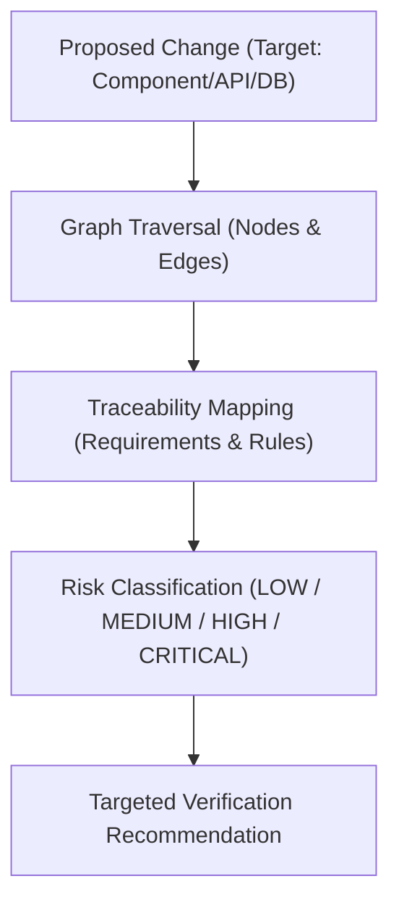

# Change Impact Analysis & Blast Radius Assessment

## Purpose

When modifying existing software components, manual inspection frequently misses transitive dependencies, breaking API contracts, or silent regressions in unreviewed UI pages. The Change Impact Analysis engine computes the exact blast radius of a proposed change using the typed `ProjectArchitectureGraph` and `RequirementTraceabilityMatrix`.

---

## Analysis Pipeline

---

## Risk Classification Criteria

- **`LOW` Risk:**
  - Pure visual or styling modifications contained to a single leaf component.
  - No database entity, API contract, or authentication workflow affected.
- **`MEDIUM` Risk:**
  - Business logic updates affecting multiple sibling modules or non-breaking API parameter additions.
- **`HIGH` Risk:**
  - Modifications to authentication, session security, encryption, or core database entities referenced across workflows.
- **`CRITICAL` Risk:**
  - Removal or modification of shared public APIs, database schema drops, or changes that invalidate existing invariants.

---

## Output Artifact: `ChangeImpactAssessment`

The assessment produces:
- `affectedRequirements`: Requirement IDs directly tied to the target.
- `affectedModules`: Modules requiring recompilation or re-testing.
- `affectedApis`: Endpoints requiring backward-compatibility verification.
- `affectedPages`: UI routes needing visual regression and accessibility checks.
- `affectedTests`: Test files that must pass before PR merge.
- `recommendedVerification`: Tailored test plan minimizing execution time while guaranteeing regression safety.
