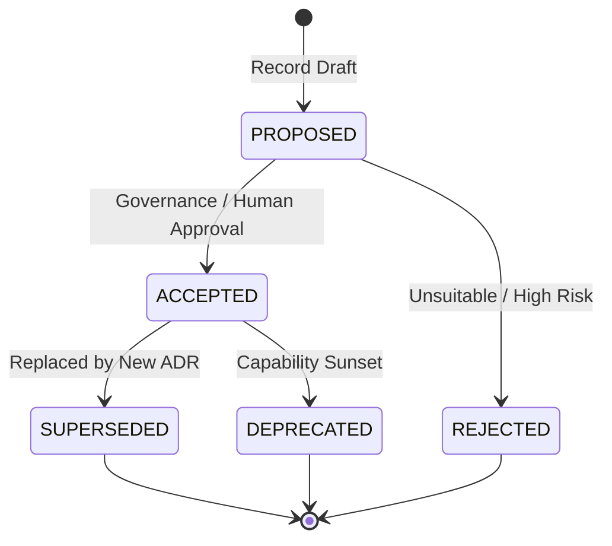

# Architecture Decision Record (ADR) Lifecycle & Governance

## Purpose

Decisions made during software architecture and interface design should not be lost in chat logs or overwritten silently when requirements evolve. Alper Design OS maintains first-class Architecture Decision Records with explicit statuses, immutable history, and bi-directional superseding pointers.

---

## Decision Lifecycle State Machine

### State Definitions
- `PROPOSED`: Evaluated candidate under consideration.
- `ACCEPTED`: Authoritative architectural baseline agreed upon by human stakeholders.
- `REJECTED`: Discarded option saved in `RejectedAlternative` registry with reconsideration conditions.
- `SUPERSEDED`: Historic decision replaced by a newer decision (`supersededBy: ADR-XXX`).
- `DEPRECATED`: Architectural component or convention no longer maintained.

---

## Bi-Directional Superseding

When an architectural premise changes (e.g. migrating from SQLite to PostgreSQL due to scale increases), the existing record is **never deleted or overwritten**:

1. New record `ADR-002` is created with `supersedes: "ADR-001"`.
2. Existing record `ADR-001` is updated in place: `status: "SUPERSEDED"`, `supersededBy: "ADR-002"`.
3. Living document `DECISIONS.md` reflects both the historical context and the active current decision.

---

## Attribution & Anti-Hallucination

Every decision record explicitly captures `approvedBy`:
- If approved by a human operator: classified as `USER_DECISION`.
- If generated autonomously by agent heuristics: classified as `SYSTEM_RECOMMENDATION`.
- System recommendations cannot override user decisions without explicit human review.
