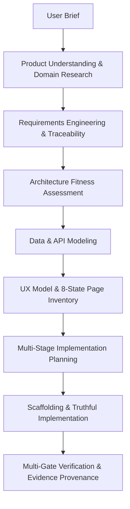

# Greenfield Project Generation Engine V1 (FAZ 1G)

## Overview

The Greenfield Project Generation Engine transforms user briefs and product ideas into fully specified, architecturally sound, buildable, and verifiable software projects. Unlike shallow template generators or boilerplate copiers, this engine follows an end-to-end disciplined engineering lifecycle:

---

## Core Guarantees & Principles

1. **Anti-Overengineering & Simplicity Guardrail:**
   - Microservices, Kafka, and Kubernetes are strictly **NOT** the default.
   - Small CRUD applications and internal tools are assigned `MONOLITH` or `MODULAR_MONOLITH` architecture with a complexity budget $\le 3$.
   - Operational simplicity is scored and prioritized.

2. **Truthful UI Policy Enforcement:**
   - Zero fabricated telemetry, fake uptime counters, or simulated streaming metrics.
   - Placeholder and sample data are unambiguously labeled with `[DEMO_DATA]` markers.
   - Data provenance and state management reflect actual system state.

3. **8-State Page Completeness:**
   Every page blueprint accounts for all 8 mandatory states:
   - `LOADING`
   - `EMPTY`
   - `SUCCESS`
   - `ERROR`
   - `PARTIAL`
   - `UNAUTHORIZED`
   - `FORBIDDEN`
   - `OFFLINE`

4. **Multi-Stack Production Support:**
   - **React + TypeScript (Vite/Tailwind)**
   - **Laravel + Blade**
   - **ASP.NET Core + Razor**
   - **Plain HTML5 + CSS + JavaScript**

5. **Requirement Traceability & Boundary Enforcement:**
   - 100% of functional requirements must trace to architectural decisions, database models, API endpoints, UI pages, and verification tests.
   - Prohibited technologies (e.g. premature distributed caching, unnecessary microservices) are rejected at the requirement boundary contract.

---

## MCP Tools Introduced in FAZ 1G

The Greenfield Engine exposes 13 canonical MCP tools (Tools 98–110):

| Tool Name | Purpose |
| :--- | :--- |
| `create_greenfield_profile` | Analyzes raw user briefs and generates a `GreenfieldProjectProfile`. |
| `derive_requirements` | Extracts functional, non-functional requirements, constraints, and Gherkin acceptance criteria. |
| `create_requirement_traceability` | Generates RTM mapping requirements to architecture, data, API, pages, and tests. |
| `recommend_greenfield_architecture` | Evaluates complexity budget, operational simplicity, and selects architectural style. |
| `recommend_greenfield_stack` | Selects optimal frontend, backend, template engine, and build tooling. |
| `create_database_blueprint` | Designs normalized relational/document entities, indexes, migrations, and masking. |
| `create_api_blueprint` | Generates OpenAPI 3.1.0 specifications with standard error and pagination envelopes. |
| `create_auth_model` | Configures secure cookie-based auth, RBAC roles, permissions, and security headers. |
| `create_page_inventory` | Builds page inventory with 8-state coverage, navigation hierarchy, and workflows. |
| `create_project_blueprint` | Synthesizes master blueprint unifying all domain, architectural, and design artifacts. |
| `create_project_plan` | Produces stage-by-stage implementation plan with dependencies and validation gates. |
| `scaffold_new_project` | Emits physical directory structure, buildable code files, Dockerfiles, and tests. |
| `evaluate_new_project_completion` | Evaluates completion gates with strict Evidence Taxonomy provenance. |

---

## Evidence Provenance Integration

All verification outcomes within Greenfield generation utilize the non-inflated Evidence Taxonomy:
- `EvidenceKind`: `STATIC_ANALYSIS`, `HEURISTIC_REVIEW`, `UNIT_TEST`, `INTEGRATION_TEST`, `RUNTIME_CHECK`, `BROWSER_TEST`, `HUMAN_REVIEW`.
- `VerificationStatus`: `VERIFIED`, `PARTIALLY_VERIFIED`, `NOT_VERIFIED`, `FAILED`, `NOT_APPLICABLE`.
- `AssuranceLevel`: `FORMAL`, `HIGH`, `MEDIUM`, `LOW`, `EXPLORATORY`.

No synthetic test or heuristic check is inflated to runtime or browser evidence.
