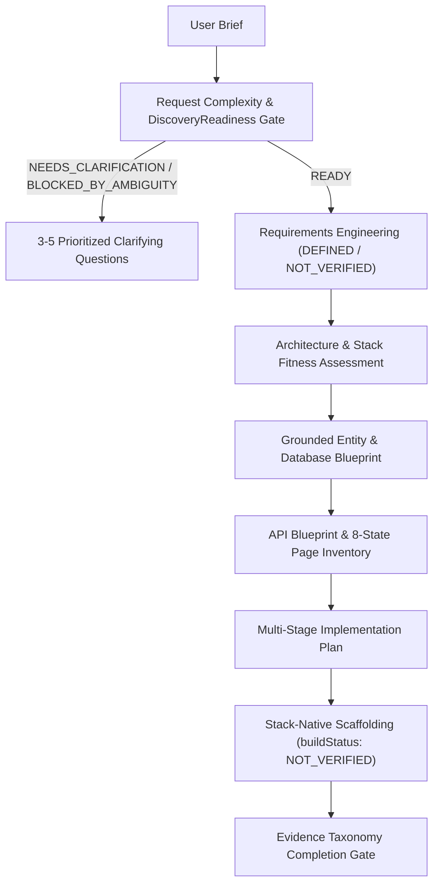

# Greenfield Project Generation Engine V1 (FAZ 1G / Remediated in FAZ 1H.1)

## Overview

The Greenfield Project Generation Engine transforms user briefs and product ideas into architecturally sound, buildable, and verifiable software projects while enforcing the universal invariant: **NO CLAIM WITHOUT EVIDENCE**.

---

## Core Guarantees & Principles (FAZ 1H.1 Remediation)

1. **DiscoveryReadiness & Downstream Discovery Guard:**
   - Every profile includes `complexityClassification` (`CLEAR_BOUNDED_TASK`, `STANDARD_PRODUCT`, `AMBIGUOUS_PRODUCT`, `HIGH_COMPLEXITY_PRODUCT`, `INSUFFICIENT_CONTEXT`) and `discoveryReadiness` (`READY`, `NEEDS_CLARIFICATION`, `BLOCKED_BY_AMBIGUITY`).
   - Ambiguous one-liners such as `"Build me an APS"` are classified as `AMBIGUOUS_PRODUCT` and blocked with at most 3–5 high-impact `clarifyingQuestions`.
   - When `discoveryReadiness.state !== 'READY'`, `createNewProjectBlueprint`, `createDatabaseBlueprint`, and `createPageInventory` refuse to fabricate production schemas.

2. **Grounded Entity Derivation (No Verb Pluralization or Generic Fallbacks):**
   - Verbs and generic placeholders (`manages`, `items`, `records`, `PrimaryEntity`) are strictly prohibited in production mode.
   - Database tables and CRUD pages are derived from grounded domain nouns (`explicitEntities`, `primaryJobs`, or domain concepts).

3. **Truthful Acceptance Criteria & Build Status:**
   - `deriveRequirements` initializes all `acceptanceCriteria` with `verified: false`, `status: 'DEFINED'`, and `verificationStatus: 'NOT_VERIFIED'`.
   - `scaffoldNewProject` emits `filesGenerated` truthfully while reporting `buildStatus: 'NOT_VERIFIED'`, `buildable: false`, and `syntaxValid: false` unless `verifiedBuildEvidence` is supplied.

4. **Multi-Stack Buildable Scaffolds & Conditional Native Docker:**
   - **React + TypeScript (`REACT_TYPESCRIPT`)**: Complete Vite entry structure (`package.json` with `@vitejs/plugin-react`, `vite.config.ts`, `tsconfig.json`, `index.html`, `src/main.tsx`, `src/vite-env.d.ts`, `src/styles/tokens.css`, `src/App.tsx`).
   - **Laravel + Blade (`LARAVEL_BLADE`)**: `composer.json`, `routes/web.php`, controllers, Blade views with `@csrf`, CSS tokens, and PHP/Composer `Dockerfile`.
   - **ASP.NET Core + Razor (`ASPNET_RAZOR`)**: `App.csproj`, `Program.cs`, controllers, Razor views with `@Html.AntiForgeryToken()`, CSS tokens, and dotnet SDK/ASP.NET runtime `Dockerfile`.
   - **Plain HTML5 + CSS + JavaScript (`PLAIN_HTML_CSS_JS`)**: `index.html`, `styles.css`, `app.js` with zero npm dependencies, and `nginx:alpine` `Dockerfile` when Docker is requested.
   - `Dockerfile` and `docker-compose.yml` are omitted when `deploymentEnvironment` does not require Docker (`LOCAL_ONLY`, `STANDALONE_HOST`, `SERVERLESS`).

5. **Gate-Specific Evidence Taxonomy Enforcement:**
   - `evaluateNewProjectCompletion` requires qualifying `evidenceRecords` per gate.
   - Missing evidence resolves to `NOT_VERIFIED` (`isComplete: false`), failed evidence to `FAILED`, and `HUMAN_REVIEW` only satisfies gates whose policy explicitly allows it.

---

## MCP Tools (Tools 98–110)

| Tool Name | Purpose |
| :--- | :--- |
| `create_greenfield_project_profile` | Analyzes user brief, classifies complexity, and computes `DiscoveryReadiness`. |
| `derive_requirements` | Extracts requirements and unverified (`DEFINED` / `NOT_VERIFIED`) acceptance criteria. |
| `create_requirement_traceability` | Generates bidirectional RTM mapping requirements to architecture, data, API, pages, and tests. |
| `recommend_architecture` | Evaluates complexity budget and selects `MONOLITH`, `MODULAR_MONOLITH`, `CLIENT_SERVER`, `SERVICE_ORIENTED`, `MICROSERVICES`, or `STATIC_FIRST`. |
| `recommend_stack` | Selects stack and marks unrequested choices as `REVERSIBLE_ASSUMPTION`. |
| `create_database_blueprint` | Designs grounded relational entities and migrations or returns `NEEDS_CLARIFICATION`. |
| `create_api_blueprint` | Generates REST endpoints and OpenAPI 3.1.0 specification from grounded tables. |
| `create_auth_model` | Configures authentication and RBAC authorization rules. |
| `create_page_inventory` | Builds 8-state page inventory from grounded entities or returns `NEEDS_CLARIFICATION`. |
| `create_project_blueprint` | Synthesizes master `NewProjectBlueprint` (enforces Downstream Discovery Guard). |
| `create_project_implementation_plan` | Produces 7-stage implementation plan with checkpoints. |
| `scaffold_new_project` | Emits stack-native buildable files with truthful `buildStatus: 'NOT_VERIFIED'`. |
| `evaluate_new_project_completion` | Evaluates completion gates strictly against qualifying `evidenceRecords`. |
