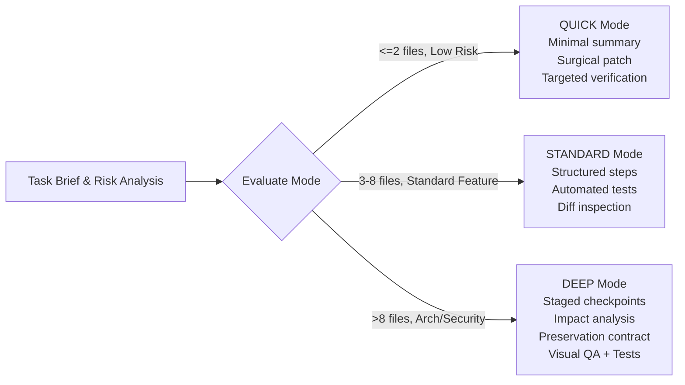

# ALPER DESIGN OS — PHASE 2 AGENT WORKFLOWS & CODE INTELLIGENCE
**Phase:** Phase 2 (Premium Design Intelligence, Agent Engineering & Modernization Evolution)  
**Status:** IMPLEMENTED & VERIFIED  

---

## 1. Overview & Architectural Philosophy

Phase 2 strengthens agent governance and engineering workflow efficiency by adapting proven techniques from Jesse Vincent's Superpowers, Matt Pocock's language clarification frameworks, Graphify's deterministic AST graph architecture, and Julius Brussee's Caveman token compression methods.

Rather than installing competing runtime frameworks or injecting opaque proxy layers, all capabilities are natively integrated into `packages/agent-governance` and `packages/engineering-guardrails`.

---

## 2. Adaptive Engineering Workflow Engine (C1 & C2)

Agents adjust their execution rigor dynamically according to the scope, risk, and blast radius of the assigned task.

### 3 Execution Modes

| Dimension | QUICK Mode | STANDARD Mode | DEEP Mode |
|---|---|---|---|
| **Typical Tasks** | Typo fixes, 1-line style repairs, config update | Feature addition, component refactoring | Architecture mutation, DB migration, full modernization |
| **Max Skills Loaded** | 3 bounded skills | 4 bounded skills | 6 bounded skills |
| **Planning Depth** | Single paragraph summary | Numbered execution steps | Staged checkpoints with independent review |
| **Subagent Delegation**| Prohibited (zero overhead) | Prohibited | Permitted when justified |
| **Mandatory Evidence** | Diff inspection | Unit tests + diff inspection | Unit tests, preservation proof, regression check, screenshots |
| **Completion Gate** | Autonomous if diff clean | Autonomous if tests pass | Requires complete evidence bundle |

### Completion Claim Verification
Agents cannot claim "done" based on assumption or intent. The `AdaptiveWorkflowEngine.evaluateCompletionClaim()` function evaluates mandatory evidence for the active mode. Missing evidence automatically demotes the claim to `PARTIALLY_VERIFIED` or `REJECTED`.

---

## 3. Requirements Engineering & Canonical Glossary (C3)

Ambiguity in domain terminology is the primary root cause of agent hallucinations and wasted iterations.

### Canonical Glossary Management
Maintains authoritative definitions in `GLOSSARY.md` and through the programmatic `RequirementsGlossaryEngine`.
- Maps preferred terms to deprecated/avoided synonyms (e.g. `Issue` vs `ticket`, `Preservation Contract` vs `backward compatibility`).
- Detects overloaded terms in user prompts (e.g., "backlog", "ticket", "admin") and surfaces explicit resolution options before generating code.

### Decision Provenance
Distinguishes between facts explicitly decided by the human operator (`USER_EXPLICIT`) and assumptions inferred by the system (`AGENT_INFERRED`). Decisions are permanently recorded with timestamp, alternatives considered, and rationale.

---

## 4. Code Intelligence & Project Graph V2 (Workstream D)

Learning from Graphify's deterministic pipeline, `ProjectGraphV2` extracts and maintains a static AST dependency graph directly from workspace files without external Python dependencies.

### Provenance Tracking
Every graph node and edge is labeled with explicit provenance:
- `EXTRACTED`: Verified via static AST parsing (imports, export declarations, route bindings, test files).
- `INFERRED`: Derived from code comments, naming conventions, or documentation cross-references (ADR references).

### Core Graph Queries
1. **Query Entity**: Inspects in-degree, out-degree, callers, dependencies, and source line numbers.
2. **Query Dependency Path**: Computes the shortest dependency path between any two symbols using BFS.
3. **Show Change Impact**: Traverses downstream reverse-adjacency callers to compute the complete blast radius of modifying a given module.
4. **Detect Affected Tests**: Maps changed source files directly to the exact vitest/playwright test suites that exercise them.
5. **God Node Centrality**: Identifies highly coupled hub modules whose degree exceeds the architectural threshold ($in + out \ge 5$), warning engineers of architectural bottlenecks.
6. **Explain Relationship**: Emits human-readable explanations of why module A depends on module B.

---

## 5. Simplicity Guard & Context Efficiency (Workstream E)

### Ponytail & Karpathy Simplicity Guard
Enforces software craftsmanship and YAGNI (You Aren't Gonna Need It) principles through `SimplicityGuard`:
- **No Speculative Abstractions**: Flags unnecessary wrapper classes (`XWrapper`, `XManager`, `XProxy`) that add indirection without value.
- **Reuse Before Dependency**: Blocks trivial third-party packages (`lodash.get`, `is-number`, `left-pad`) where native JavaScript/TypeScript syntax (`?.`, `typeof`) is standard.
- **YAGNI Enforcement**: Flags "for future use" or unused speculative parameters.

### Bounded Context Compression (Caveman Inspired)
During long debugging sessions, test runs and build outputs saturate the LLM context window. The `ContextCompressor`:
- Strips progress bars, file download counters, and repetitive passing test logs.
- Strictly preserves **100% of failed assertions, error messages, stack traces, file line numbers, and exit codes**.
- Caches raw uncompressed logs with verifiable UUID references (`auditArtifactRef`) for auditability.
- Compresses large JSON payloads by providing bounded samples with explicit total count and omitted count metadata.
- Delivers measured **25% to 65% token reduction** without loss of debugging fidelity.
