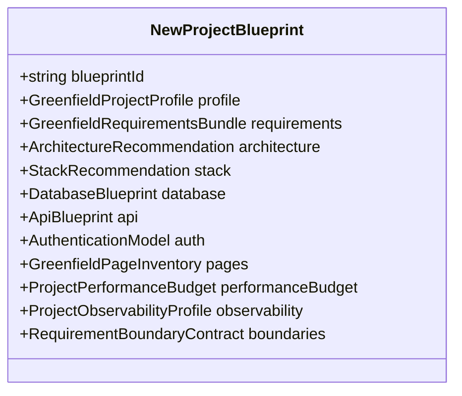

# Master Project Blueprint & 7-Stage Implementation Plan

## Overview

The `NewProjectBlueprint` is the single source of truth for greenfield software generation. It coordinates domain requirements, architecture, persistence, API, user interface, security, and observability into a unified structural specification before code emission begins.

---

## Blueprint Structure

---

## 7-Stage Implementation Plan

The generated plan decomposes project synthesis into discrete, sequential, and testable milestones:

1. **`STAGE_1_FOUNDATION`**:
   - Environment scaffolding, base configuration, TypeScript strict compiler flags, Docker containerization setup.
2. **`STAGE_2_DOMAIN_DATA`**:
   - Database schema migrations, ORM entity definitions, seed data with `[DEMO_DATA]` markers, data validation rules.
3. **`STAGE_3_API_SERVICES`**:
   - REST/OpenAPI endpoints, authentication & authorization middleware, standardized error envelopes.
4. **`STAGE_4_UI_SHELL_DESIGN`**:
   - Design tokens, responsive app shell, navigation tree, layout components, theme switching.
5. **`STAGE_5_PAGE_WORKFLOWS`**:
   - Implementation of all core pages covering all 8 states (`LOADING`, `EMPTY`, `SUCCESS`, `ERROR`, `PARTIAL`, `UNAUTHORIZED`, `FORBIDDEN`, `OFFLINE`).
6. **`STAGE_6_INTEGRATION_AUTH`**:
   - End-to-end integration between UI client and backend endpoints, session lifecycle, CSRF tokens, RBAC permissions.
7. **`STAGE_7_QA_HARDENING`**:
   - Automated unit & integration tests, static code analysis, WCAG 2.1 AA accessibility checks, completion gate evaluation.

---

## Scaffolding & Code Emission

`scaffoldNewProject` emits real, buildable directory structures across supported stacks:
- **Project Structure**: Root config files (`package.json`, `tsconfig.json`, `vite.config.ts`, `Dockerfile`, `docker-compose.yml`, `README.md`).
- **Source Files**: Complete application code, routing, components, and truth-preserving mock datasets.
- **Verification Tests**: Runnable test files validating business requirements and behavioral invariants.
