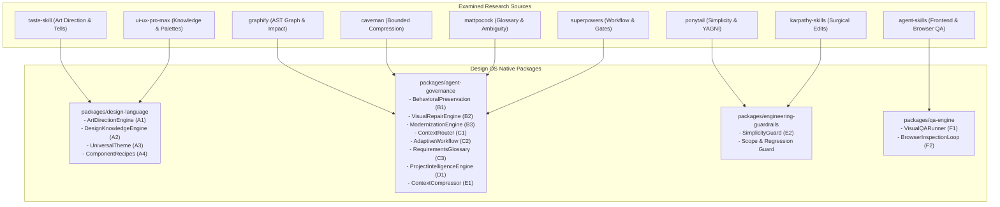

# ALPER DESIGN OS — PHASE 2 CAPABILITY EXTRACTION & RESEARCH MATRIX
**Evaluation Date:** October 2026  
**Phase:** Phase 2 (Premium Design Intelligence, Agent Engineering & Modernization Evolution)  
**Author:** Principal Software Architect, Staff Product Designer & AI Agent Systems Engineer  

---

## 1. Executive Summary & Research Methodology

To evolve ALPER DESIGN OS into a premium, context-aware engineering operating system, we conducted an empirical, source-level study of 9 influential agentic frameworks/skills and 9 canonical enterprise design systems. Every external repository was examined directly from its active default branch, checking commit trees, manifests, licensing terms, and execution mechanics.

The objective is **not wholesale replication or blindly installing 9 disparate plugins**, but rather extracting proven technical patterns, establishing clear attribution, and implementing clean native capabilities inside Design OS's deterministic architecture.

---

## 2. Examined Source Repositories & Exact Commit Baseline

| Index | Repository | Commit SHA | License | Primary Author / Organization | Key Focus Area |
|---|---|---|---|---|---|
| 1 | [obra/superpowers](https://github.com/obra/superpowers) | `2ce8aa15d05bd57213e6f746f953aafb7ded7a8b` | MIT License | Jesse Vincent | Agent workflows, planning, verification gates |
| 2 | [Leonxlnx/taste-skill](https://github.com/Leonxlnx/taste-skill) | `6010f91a9935f1c167dfc500fb1a475681892e6b` | MIT License | Leonxlnx | Art direction, anti-generic UI rules, browser probe |
| 3 | [addyosmani/agent-skills](https://github.com/addyosmani/agent-skills) | `aeac41d4d005999432bb7312f7ff06383a91d59d` | MIT License | Addy Osmani | Engineering skills, frontend craftsmanship, ADRs |
| 4 | [juliusbrussee/caveman](https://github.com/juliusbrussee/caveman) | `bad48a0e1df55e05e3f52249afa35ecc1909ee76` | Apache 2.0 | Julius Brussee | Token compression, bounded test/build log reduction |
| 5 | [Graphify-Labs/graphify](https://github.com/Graphify-Labs/graphify) | `847a93f3cab5e2c82ea9170014b21cd2c52a4417` | Apache 2.0 | Graphify-Labs | AST-driven deterministic project graph, god nodes, impact analysis |
| 6 | [nextlevelbuilder/ui-ux-pro-max-skill](https://github.com/nextlevelbuilder/ui-ux-pro-max-skill) | `623a9a9037d006ea727f8213f084d02a6b6f11b5` | MIT License | Next Level Builder | Curated UI/UX knowledge base, palette/font pairing recipes |
| 7 | [dietrichgebert/ponytail](https://github.com/dietrichgebert/ponytail) | `09c434ab73ca43761c5d8b0c5d341926c2fba710` | MIT License | DietrichGebert | Simplicity guard, YAGNI enforcement, reuse-first rules |
| 8 | [multica-ai/andrej-karpathy-skills](https://github.com/multica-ai/andrej-karpathy-skills) | `2c606141936f1eeef17fa3043a72095b4765b9c2` | MIT License / Public | multica-ai / Karpathy | Surgical changes, assumption surfacing, zero speculation |
| 9 | [mattpocock/skills](https://github.com/mattpocock/skills) | `5beb35b040e3de97e54fa9e386d7e42d15c295c2` | MIT License | Matt Pocock | Shared vocabulary, canonical glossary, ambiguity detection |

---

## 3. Detailed Repository Capability Analysis

### 3.1. Leonxlnx/taste-skill (`6010f91a9935f1c167dfc500fb1a475681892e6b`)
- **What it implements:** Curated art-direction profiles ("tastes"), anti-generic design heuristics ("AI tells"), and Chrome DevTools Protocol (CDP) scripts for inspecting live web apps to detect visual monotony, bad contrast, and poor hierarchy.
- **How it works:** Library of structured JSON directions (`palettes.json`, `directions.json`, `type.json`, `heroes.json`) combined with CLI scripts (`probe.mjs`, `lint.mjs`) that capture element bounding boxes, computed styles, and font metrics via CDP.
- **What makes it effective:** Directly attacks the "AI aesthetic" (monotonous purple gradients, uniform rounded cards, unreadable low-contrast grays, gratuitous animations).
- **Limitations:** Focuses heavily on consumer marketing sites and SaaS landing pages; lacks deep enterprise ERP/APS density models, complex data grid behaviors, and keyboard-first operational workflows.
- **License obligations:** MIT License. Permissive with attribution.
- **Existing equivalent in Design OS:** `packages/design-language/src/design-intent.ts`, `design-critic.ts`, `anti-patterns/`.
- **Missing capabilities:** Native multi-candidate design direction generation with explicit scoring, product-family specific art direction (ERP, APS, MES, Developer Workspace).
- **Adoption strategy:** **ADAPT & EXTEND**.
- **Expected benefit:** Elevates Design OS generated and modernized interfaces beyond generic dashboard templates into differentiated, purposeful designs.
- **Complexity & Risk:** Medium complexity; low security risk (pure design heuristics and standard browser automation).
- **Acceptance test:** Art direction engine generates 3 distinct typed candidates for enterprise and consumer scenarios, ranking them with explicit criteria.

---

### 3.2. nextlevelbuilder/ui-ux-pro-max-skill (`623a9a9037d006ea727f8213f084d02a6b6f11b5`)
- **What it implements:** Searchable curated design dataset covering 79 styles, 192 color palettes, 74 font pairings, 119 UX guidelines, and 25 chart patterns across 22 technology stacks.
- **How it works:** Relies on compact CSV and JSON knowledge tables (`products.csv`, `styles.csv`, `colors.csv`, `typography.csv`, `ux-guidelines.csv`) queried by keyword and product domain.
- **What makes it effective:** Provides concrete, empirically proven font and color combinations rather than hallucinating hex codes or random generic typefaces.
- **Limitations:** Data is stored in disconnected CSVs; lacks deep semantic typing, component lifecycle constraints, and light/dark bidirectional mathematical contrast validation.
- **License obligations:** MIT License.
- **Existing equivalent in Design OS:** `packages/source-intelligence`, `packages/design-language/src/tokens-v2`.
- **Missing capabilities:** Integrated design recommendation engine that links product category rules directly to layout recipes, component patterns, and universal theme tokens.
- **Adoption strategy:** **REIMPLEMENT NATIVELY**.
- **Expected benefit:** Grounded, high-velocity retrieval of industry-standard typography, color palettes, and UX patterns with zero external network dependency.
- **Complexity & Risk:** Low-medium complexity; zero security risk.
- **Acceptance test:** Querying recommendation engine for "Enterprise ERP" yields high-density tabular layout, semantic status palette, and robust font pairings with WCAG AA compliance.

---

### 3.3. Graphify-Labs/graphify (`847a93f3cab5e2c82ea9170014b21cd2c52a4417`)
- **What it implements:** Deterministic code intelligence pipeline generating AST-based dependency graphs, identifying central "god nodes", circular dependencies, and change-impact propagation paths.
- **How it works:** Modular Python architecture: `detect()` -> `extract()` -> `build()` -> `cluster()` -> `analyze()` -> `report()`. Uses AST parsing to extract symbols, calls, imports, and exports into a graph with community detection.
- **What makes it effective:** 100% deterministic and local; no external LLM hallucination for structural facts; separates verified AST edges from inferred relationships.
- **Limitations:** Implemented as a separate Python library with heavy dependencies (`networkx`, `scipy`); lacks native TypeScript AST engine integration for modern web monorepos.
- **License obligations:** Apache License 2.0. Requires NOTICE and patent/copyright compliance.
- **Existing equivalent in Design OS:** `packages/agent-governance/src/project-intelligence-engine.ts`.
- **Missing capabilities:** Formal distinction between `EXTRACTED` (AST verified) vs `INFERRED` provenance, "god node" centrality ranking, graph diffing, and affected test suite detection.
- **Adoption strategy:** **REIMPLEMENT NATIVELY IN TYPESCRIPT** into existing `ProjectIntelligenceEngine`.
- **Expected benefit:** Accurate, instantaneous change impact analysis, test suite targeting, and architecture drift detection without external Python runtimes.
- **Complexity & Risk:** Medium complexity; zero security risk (static analysis on workspace files).
- **Acceptance test:** Project graph builds AST nodes across packages, identifies highly connected modules, and determines affected tests when a core contract changes.

---

### 3.4. JuliusBrussee/caveman (`bad48a0e1df55e05e3f52249afa35ecc1909ee76`)
- **What it implements:** Context token compression techniques, bounded log summarization ("Blocks" reducing test run logs by 60-80%), and concise agent communication filters.
- **How it works:** Regex and rule-based line filtering that strips redundant progress bars, boilerplate CLI banners, and repeating logs while strictly retaining errors, failure traces, and exit codes.
- **What makes it effective:** Substantially reduces context window saturation during long multi-step agent debugging sessions.
- **Limitations:** Overly terse communication can obscure subtle warnings if uncalibrated; third-party proxy components in upstream repo introduce supply-chain risks.
- **License obligations:** Apache License 2.0.
- **Design OS Policy Safeguard:** Strictly reject all model proxying, token interception, or credential modification.
- **Existing equivalent in Design OS:** None for log compression.
- **Missing capabilities:** Native bounded compression for vitest logs, build outputs, large JSON responses, and repository search results.
- **Adoption strategy:** **ADAPT (NATIVE LOG & RESULT COMPRESSOR ONLY)**.
- **Expected benefit:** Dramatically cleaner agent context, 40-70% lower token footprint during test execution, while 100% preserving failures, stack traces, and exit codes.
- **Complexity & Risk:** Low complexity; zero security risk when implemented locally.
- **Acceptance test:** Test logs with 500 lines compressed to <50 lines containing all failure traces and summary statistics.

---

### 3.5. DietrichGebert/ponytail (`09c434ab73ca43761c5d8b0c5d341926c2fba710`)
- **What it implements:** "Lazy senior developer" behavioral constraints: enforce smallest complete change, reuse existing codebase helpers before writing new ones, prefer standard library/platform features, strictly forbid speculative abstractions.
- **How it works:** Skill guidelines and automated diff checks that evaluate code additions versus deletions, flagging unnecessary layers and wrapper functions.
- **What makes it effective:** Directly curtails agent hallucination and over-engineering tendencies.
- **Limitations:** Rule-only; requires automated guardrail enforcement to prevent regression.
- **License obligations:** MIT License.
- **Existing equivalent in Design OS:** `packages/engineering-guardrails`.
- **Missing capabilities:** Automated YAGNI and anti-speculation checks in code reviews; explicit reuse-first scoring for components and utilities.
- **Adoption strategy:** **ADAPT INTO ENGINEERING GUARDRAILS**.
- **Expected benefit:** Tighter pull requests, less dead code, higher reuse of existing design system components.
- **Complexity & Risk:** Low complexity; low risk.
- **Acceptance test:** Simplicity guard checks reject speculative wrapper classes and promote existing monorepo helpers.

---

### 3.6. multica-ai/andrej-karpathy-skills (`2c606141936f1eeef17fa3043a72095b4765b9c2`)
- **What it implements:** Coding heuristics derived from Andrej Karpathy's observed LLM coding pitfalls: think before coding, surface tradeoffs, surgical edits, verify against real success criteria, never rewrite adjacent working code.
- **How it works:** Structured behavioral prompts and self-critique checklists executed before and after code modification.
- **What makes it effective:** Prevents agent "scope drift" and accidental degradation of adjacent working features.
- **Limitations:** Relies on agent discipline unless verified by automated diff and test gates.
- **License obligations:** MIT / Public.
- **Existing equivalent in Design OS:** `packages/agent-governance/src/scope-guard.ts`, `regression-guard.ts`.
- **Missing capabilities:** Explicit "Tradeoff Surfacing" and "Surgical Diff Boundary" enforcement in the repair/modernize pipeline.
- **Adoption strategy:** **ADAPT INTO MODERNIZATION & REPAIR ENGINE**.
- **Expected benefit:** Eliminates collateral damage during visual and architectural refactoring.
- **Complexity & Risk:** Low complexity; low risk.
- **Acceptance test:** Repair engine executes surgical changes leaving adjacent untouched routes and components unmodified.

---

### 3.7. mattpocock/skills (`5beb35b040e3de97e54fa9e386d7e42d15c295c2`)
- **What it implements:** Shared vocabulary engineering, canonical glossary management, ambiguity detection, and separating architectural decision tickets from implementation slices (`wayfinder`, `to-spec`, `grill-with-docs`).
- **How it works:** Maintains an authoritative project glossary (`GLOSSARY.md`), scans prompts for conflicting terms, and forces explicit user resolution on material ambiguities before code generation.
- **What makes it effective:** Solves the root cause of agent misunderstandings: vague or overloaded domain terms.
- **Limitations:** Can create process friction if applied to trivial one-line bug fixes.
- **License obligations:** MIT License.
- **Existing equivalent in Design OS:** ADR generator in `packages/software-intelligence`.
- **Missing capabilities:** Project-level canonical glossary engine, automated ambiguity detector, and distinguishing user decisions from inferred assumptions.
- **Adoption strategy:** **REIMPLEMENT NATIVELY IN AGENT GOVERNANCE**.
- **Expected benefit:** Prevents costly rework by resolving domain terminology up front.
- **Complexity & Risk:** Low-medium complexity; low risk.
- **Acceptance test:** Requirements engine detects ambiguous term, surfaces explicit options, and persists agreed definition into canonical glossary.

---

### 3.8. obra/superpowers (`2ce8aa15d05bd57213e6f746f953aafb7ded7a8b`)
- **What it implements:** Full agent execution lifecycle: structured brainstorming, step-by-step execution plans, verification-before-completion gates, systematic root-cause debugging, git worktree hygiene.
- **How it works:** Specialized skill playbooks with mandatory gates. Completion claims require execution logs and test evidence; agents cannot claim "done" based on assumption.
- **What makes it effective:** High rigor; eliminates premature completion declarations.
- **Limitations:** Heavy process overhead for tiny tasks; multi-agent dispatch can be costly.
- **License obligations:** MIT License.
- **Existing equivalent in Design OS:** `packages/agent-governance/src/claim-verifier.ts`, `completion-contract.ts`, `action-planner.ts`.
- **Missing capabilities:** Adaptive task-size execution modes (QUICK, STANDARD, DEEP) that scale rigor to task scope.
- **Adoption strategy:** **ADAPT & INTEGRATE INTO ADAPTIVE WORKFLOW ENGINE**.
- **Expected benefit:** Appropriate verification depth without bogging down small fixes in heavy ceremony.
- **Complexity & Risk:** Medium complexity; low risk.
- **Acceptance test:** Quick tasks execute with minimal overhead, while Deep tasks mandate full architecture review, impact analysis, and verification evidence.

---

### 3.9. addyosmani/agent-skills (`aeac41d4d005999432bb7312f7ff06383a91d59d`)
- **What it implements:** 25 developer skills spanning frontend engineering, browser DevTools inspection, performance optimization, ADR documentation, and doubt-driven development.
- **How it works:** Practical checklists, code templates, and DevTools inspection scripts for measuring rendering performance, layout shifts, and accessibility.
- **What makes it effective:** Pragmatic, production-oriented engineering standards from seasoned web platform leadership.
- **Limitations:** Standalone skill markdown files; requires programmatic tooling to automate during CI.
- **License obligations:** MIT License.
- **Existing equivalent in Design OS:** `packages/qa-engine`, `packages/software-intelligence`.
- **Missing capabilities:** End-to-end browser inspection loop that detects layout shifts, contrast failures, and responsive clipping with automated remediation.
- **Adoption strategy:** **ADAPT INTO QA ENGINE & VISUAL INSPECTOR**.
- **Expected benefit:** Production-grade browser validation across multiple desktop and mobile viewports.
- **Complexity & Risk:** Medium complexity; low risk.
- **Acceptance test:** QA engine runs Playwright inspection on modernized pages, verifying contrast, overflow, and rendering stability across 4 canonical viewports.

---

## 4. Official Enterprise Design Systems & Architectural Mapping

| Design System | Architecture & Primitives | Theming & Tokens | Key Strength for Design OS | Adoption Decision |
|---|---|---|---|---|
| **shadcn/ui** | Headless Radix Primitives + Tailwind CSS + CVA | CSS Variables, Semantic Tokens (`--background`, `--foreground`, `--primary`) | Copy-paste ownership, zero lock-in, accessible by default | **PRIMARY COMPONENT PATTERN REFERENCE** |
| **Radix Themes** | Radix Primitives + Stitches/CSS Modules | Scales: 12-step color radices, gray pairing, radius, typography | Cohesive contrast ratios, light/dark mathematical harmony | **THEME & PALETTE TOKEN FOUNDATION** |
| **Mantine** | Modular React components + Emotion/CSS Modules | `MantineProvider`, light/dark/auto schemes, color manipulation utilities | Enterprise forms, dense DataGrid, notification manager | **ENTERPRISE DATA DENSITY REFERENCE** |
| **Chakra UI / Ark UI** | Headless Zag.js state machines + Styled System | Token system, dark mode semantic tokens, multi-framework | State-machine driven component behaviors (tabs, combobox, dialogs) | **INTERACTION & STATE MACHINE REFERENCE** |
| **React Aria** | Adobe unstyled accessibility hooks & components | CSS variable hooks, strict WCAG 2.1 AA keyboard navigation | Industry gold-standard focus management & screen reader semantics | **ACCESSIBILITY CONTRACT REFERENCE** |
| **Material Design 3** | Tonal palettes, role-based elevation, dynamic color | MD3 Design Tokens, M3 color roles (surface-container, on-surface) | Strict semantic role hierarchy, elevation token contracts | **ELEVATION & SURFACE SEMANTICS** |
| **Fluent 2** | Microsoft Web/Desktop UI components | High-density tokens, design tokens library, Windows 11 alignment | Enterprise desktop productivity, 125% DPI awareness, grid density | **ENTERPRISE ERP / APS DENSITY PROFILE** |
| **Tailwind CSS** | Utility-first CSS engine | CSS variable theme extensions, `dark:` variant, `@container` | Standard styling runtime across all generated & modernized components | **DEFAULT GENERATED STYLING LAYER** |

---

## 5. Consolidated Adoption & Architecture Strategy

### Strategic Decisions:
1. **Zero External Framework Rewrites:** Do not wrap or deploy 3rd-party CLI wrappers or model proxies. All logic is implemented natively in TypeScript within existing monorepo packages.
2. **Preserve Compatibility:** The 124 existing canonical MCP tools are preserved intact. New intelligence is exposed through enhanced payloads and dedicated typed utilities.
3. **Evidence-Grounded QA:** Real Playwright browser instances take actual screenshots across 4 viewports in Light and Dark themes. No fabricated scores.
4. **Behavioral Invariance:** Modernization and repair operations mandate behavioral preservation contracts ensuring zero route, API, or data regressions.
