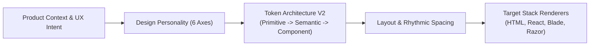

# Alper Canonical Design Language

## Purpose
The Alper Canonical Design Language provides a technology-agnostic foundation for user interfaces. Instead of binding UI decisions directly to a specific framework (e.g. React or Tailwind), it models design intent, design personality, tokens, and layout principles at a canonical level.

## Core Flow

## Token Architecture V2
- **Level 1 (Primitives):** Base color palettes, 4px rhythmic spacing scale (`space.1` to `space.16`), radius scale, font families, and duration/easing.
- **Level 2 (Semantics):** Contextual meaning with multi-theme support (`surface.default`, `text.primary`, `action.primary`, `status.critical`, `focus.ring`). Supports `LIGHT`, `DARK`, and `HIGH_CONTRAST`.
- **Level 3 (Components):** Component-specific bindings mapped to semantic tokens (`button.primary.background`, `table.header.background`, `input.focus.ring`).

## Density Modes
- `COMPACT`: 4px rhythmic spacing, 32px inputs/buttons, 36px table rows (high-density data tools).
- `COMFORTABLE`: 8px base spacing, 40px inputs/buttons, 48px table rows (standard SaaS).
- `SPACIOUS`: 12px base spacing, 48px inputs/buttons, 60px table rows (consumer/media).

## Guidelines
1. Never hardcode raw hex colors in CSS or component code; use semantic token variables (`var(--alper-action-primary)`).
2. Avoid magic numbers in margin or padding; adhere strictly to the 4px rhythmic scale.
3. Support local system font fallbacks first-class to guarantee fast rendering and zero layout shift.
